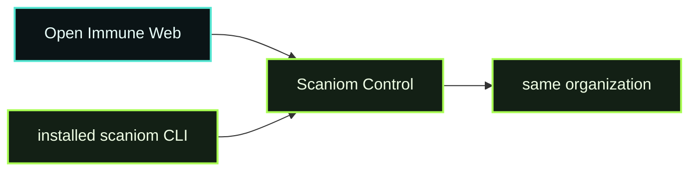

# D00 - OIS Auth

> **D00 · OIS AUTH** · **PUBLIC / NATIVE SCANIOM FIRST** · `run.sh = INTERNAL / ACCEPTANCE ONLY`



**Public path:** Workbench + real Scaniom Web/CLI authority. Normal users do not run this directory's shell harness.

## Public / native Scaniom flow

1. Select the Cloud or explicit self-hosted/private profile in Open Immune.
2. Verify the same Control from the installed CLI.
3. Authorize CLI and Open Immune separately through Scaniom device authorization.
4. Confirm the same operator and organization.

```bash
scaniom profile use cloud
scaniom profile test cloud
scaniom login
scaniom whoami
scaniom auth status
```

```text
Browser -> OIS Auth -> Scaniom Control <- installed Scaniom CLI
                        |
                  same organization
```

No browser token is shared with the CLI and no CLI credential is copied into the browser.

## Completion

D00 completes from real Scaniom profile, identity, and organization authority.

## Internal / engineering acceptance

`run.sh` is an engineering/CI parity harness. It is not the public learning workflow.

```bash
bash demos/d00-account-auth/run.sh
```
