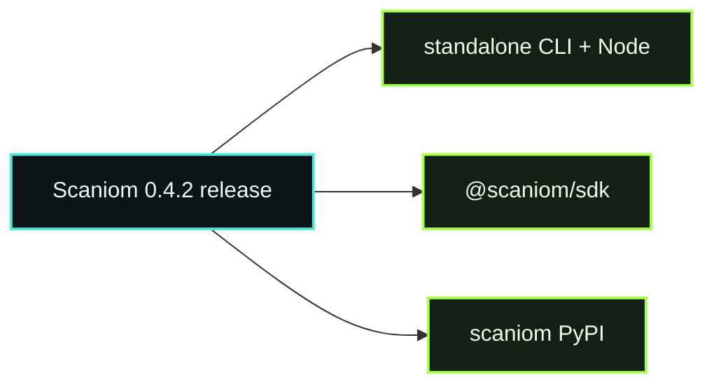

# D01 - Public Install

> **D01 · PUBLIC INSTALL** · **PUBLIC / NATIVE SCANIOM FIRST** · `run.sh = INTERNAL / ACCEPTANCE ONLY`



**Normal users do not run this directory's shell harness as the public Lab workflow.**
**Public path:** verify released Scaniom artifacts. Normal users do not need a private Scaniom source checkout and do not use this directory's shell harness as the product workflow.

## Public / native Scaniom flow

```bash
scaniom version
scaniom artifacts supply-chain
scaniom profile test cloud
```

For L2 package verification:

```bash
npm install @scaniom/sdk@0.4.2
python3 -m pip install scaniom==0.4.2
```

D01 establishes that the CLI/runtime and SDK distributions come from the accepted public R18 / 0.4.2 release.

## Completion

The Lab verifies public release identity, native standalone CLI/runtime, npm SDK, and PyPI SDK. The local D01 receipt is credential-free and exists only because registry/install verification is local execution evidence rather than Control runtime state.

## Internal / engineering acceptance

```bash
bash demos/d01-public-install/run.sh
```

The harness writes `.demo/receipts/d01-public-install.json` only after all distribution checks pass.
