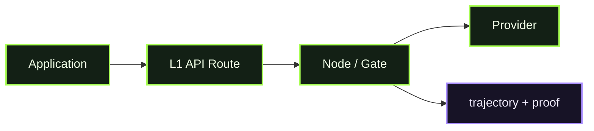

# D02 - L1 Full Cycle

> **D02 · L1 API ROUTE** · **PUBLIC / NATIVE SCANIOM FIRST** · `run.sh = INTERNAL / ACCEPTANCE ONLY`



### Use your own Scaniom names

Commands shown in Workbench resolve the selected real environment/workload/Node. Names such as `scaniom-demo-agent`, `prod-ai-01`, or `open-immune-node` are examples only. Check your own state with:

```bash
scaniom env list
scaniom workload list
scaniom node list
```

**Public path:** real application/provider traffic through Scaniom Node / L1. Normal users do not run this directory's shell harness.

## Public / native Scaniom flow

```text
Application -> Scaniom Node / L1 -> provider
                    |
             identity + policy + Gate
                    |
              trajectory + proof
```

Configure Node-local BYOK and L1:

```bash
scaniom provider add openai --node "$YOUR_NODE_NAME" --workload "$YOUR_WORKLOAD" --model "$YOUR_MODEL"
scaniom secret configure OPENAI_API_KEY --node "$YOUR_NODE_NAME"
scaniom node restart
scaniom attach l1 --workload "$YOUR_WORKLOAD" --node "$YOUR_NODE_NAME" --preset openai --model "$YOUR_MODEL"
scaniom runtime identity bootstrap --workload "$YOUR_WORKLOAD" --attachments l1
scaniom runtime identity status --workload "$YOUR_WORKLOAD"
scaniom attach test l1 --workload "$YOUR_WORKLOAD" --model "$YOUR_MODEL" -- "Say hello in one sentence"
```

No L2 SDK is required for L1.

## Completion

```bash
scaniom attach status --workload "$YOUR_WORKLOAD"
scaniom trajectory list --limit 100
scaniom proof correlated list --limit 50
```

D02 closes from selected-workload `provider_proxy` evidence and valid signed proof.

## Internal / engineering acceptance

```bash
bash demos/d02-l1-full-cycle/run.sh
```
