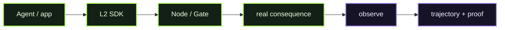

# D03 - L2 Agent SDK

> **D03 · L2 SDK** · **PUBLIC / NATIVE SCANIOM FIRST** · `run.sh = INTERNAL / ACCEPTANCE ONLY`



### Use your own Scaniom names

Commands shown in Workbench resolve the selected real environment/workload/Node. Names such as `scaniom-demo-agent`, `prod-ai-01`, or `open-immune-node` are examples only. Check your own state with:

```bash
scaniom env list
scaniom workload list
scaniom node list
```

**Public path:** instrument the real application/agent with released TypeScript or Python SDK. Normal users do not run this directory's shell harness.

## Public / native Scaniom flow

```text
app/agent -> L2 SDK guard -> Scaniom Node/Gate -> consequence -> observe
                                                       |
                                               L2 trajectory/proof
```

```bash
npm install @scaniom/sdk@0.4.2
# or
python3 -m pip install scaniom==0.4.2

scaniom attach l2 --workload "$YOUR_WORKLOAD" --lang typescript
scaniom runtime identity bootstrap --workload "$YOUR_WORKLOAD" --attachments l1,l2,l4
scaniom runtime identity status --workload "$YOUR_WORKLOAD"
```

L2 preserves the shared B1 `l1,l2,l4` identity scope. Provider routes are optional for semantic action gating; they are required only when the application also sends model/provider traffic.

The real application wraps its actual harmless consequence with SDK guard/observe semantics. Provider credentials stay Node/runtime-local.

## Completion

D03 closes only from selected-workload `sdk` pre/post evidence and attachment-specific signed proof.

## Internal / engineering acceptance

The harness runs both released SDKs and local harmless consequences:

```bash
bash demos/d03-l2-agent-sdk/run.sh
```
