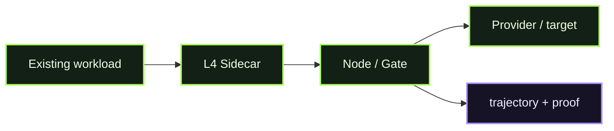

# D04 - L4 Sidecar

> **D04 · L4 SIDECAR** · **PUBLIC / NATIVE SCANIOM FIRST** · `run.sh = INTERNAL / ACCEPTANCE ONLY`



### Use your own Scaniom names

Commands shown in Workbench resolve the selected real environment/workload/Node. Names such as `scaniom-demo-agent`, `prod-ai-01`, or `open-immune-node` are examples only. Check your own state with:

```bash
scaniom env list
scaniom workload list
scaniom node list
```

D04 is a Workbench-first real Scaniom flow. **Normal users do not run** this directory's shell harness.

## Public / native Scaniom flow

1. Complete OIS Auth and select the real environment/workload.
2. Configure the provider route/BYOK when model traffic needs one.
3. Establish or reuse the shared B1 `l1,l2,l4` runtime identity.
4. Start/place the released sidecar beside the actual workload.
5. Point real workload traffic at the sidecar.
6. Verify `sidecar` evidence and proof.

```bash
scaniom attach l4 --workload "$YOUR_WORKLOAD" --port 8790
scaniom runtime identity bootstrap --workload "$YOUR_WORKLOAD" --attachments l1,l2,l4
scaniom runtime identity status --workload "$YOUR_WORKLOAD"
scaniom attach test l4 --workload "$YOUR_WORKLOAD" --model "$YOUR_MODEL" -- "Say hello"
scaniom attach status --workload "$YOUR_WORKLOAD"
```

## Completion

L4 verifies only from live selected-workload `sidecar` evidence and valid signed proof.

## Internal / engineering acceptance

```bash
bash demos/d04-l4-sidecar/run.sh
```
