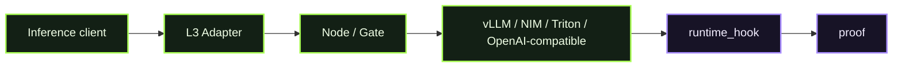

# D05 - L3 Model Runtime

> **D05 · L3 MODEL RUNTIME** · **PUBLIC / NATIVE SCANIOM FIRST** · `run.sh = INTERNAL / ACCEPTANCE ONLY`



### Use your own Scaniom names

Commands shown in Workbench resolve the selected real environment/workload/Node. Names such as `scaniom-demo-agent`, `prod-ai-01`, or `open-immune-node` are examples only. Check your own state with:

```bash
scaniom env list
scaniom workload list
scaniom node list
```

D05 is a Workbench-first real Scaniom L3 flow. **Normal users do not run** this directory's shell harness.

## Accepted Scaniom runtime kinds

Use the exact released Scaniom `--kind` identifier for the runtime you actually operate:

| Runtime | Scaniom `--kind` |
| --- | --- |
| vLLM | `vllm` |
| NVIDIA NIM | `nvidia_nim` |
| Triton HTTP V2 JSON | `triton` |
| OpenAI-compatible inference endpoint | `openai_compatible` |

These identifiers are part of the accepted L3 CLI/runtime contract; they are not Open Immune aliases.

## Public / native Scaniom flow

Gate sits immediately before real vLLM, NVIDIA NIM, Triton HTTP V2 JSON, or OpenAI-compatible inference.

```bash
export YOUR_RUNTIME_KIND="openai_compatible"   # or: vllm | nvidia_nim | triton
export YOUR_RUNTIME_URL="http://127.0.0.1:8000"
export YOUR_WORKLOAD="customer-model-runtime"
export YOUR_MODEL="your-model-name"

scaniom attach l3 \
  --workload "$YOUR_WORKLOAD" \
  --kind "$YOUR_RUNTIME_KIND" \
  --endpoint "$YOUR_RUNTIME_URL" \
  --model "$YOUR_MODEL"

scaniom runtime identity bootstrap \
  --workload "$YOUR_WORKLOAD" \
  --attachments l3

scaniom runtime identity status --workload "$YOUR_WORKLOAD"

scaniom attach l3 \
  --workload "$YOUR_WORKLOAD" \
  --kind "$YOUR_RUNTIME_KIND" \
  --endpoint "$YOUR_RUNTIME_URL" \
  --port 8792 \
  --run

scaniom attach test l3 \
  --workload "$YOUR_WORKLOAD" \
  --model "$YOUR_MODEL" \
  -- "Say hello"
```

The L3 scope is **explicit opt-in**. Gate executes before inference. Post-outcome evidence is emitted as `runtime_hook`. If Gate blocks, the model is not invoked; ambiguous inference dispatch is not blindly replayed.

## Completion

The selected workload must have an active real model runtime, explicit `l3` runtime identity, `runtime_hook` evidence, and a valid attachment-specific correlated proof. A configured diagram or unrelated L1/L2/L4 evidence cannot close D05.

## Internal / engineering acceptance

The shell harness is retained only to exercise the same released Scaniom contracts deterministically during engineering/CI acceptance.

```bash
SCANIOM_L3_KIND="$YOUR_RUNTIME_KIND" \
SCANIOM_L3_TARGET_URL="$YOUR_RUNTIME_URL" \
SCANIOM_WORKLOAD="$YOUR_WORKLOAD" \
SCANIOM_MODEL="$YOUR_MODEL" \
bash demos/d05-l3-model-runtime/run.sh
```
