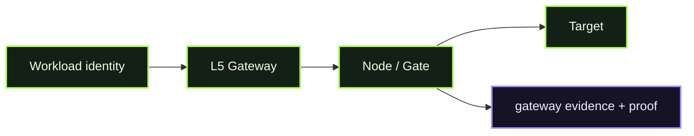

# D06 - L5 Environment Gateway

> **D06 · L5 ENVIRONMENT GATEWAY** · **PUBLIC / NATIVE SCANIOM FIRST** · `run.sh = INTERNAL / ACCEPTANCE ONLY`



### Use your own Scaniom names

Commands shown in Workbench resolve the selected real environment/workload/Node. Names such as `scaniom-demo-agent`, `prod-ai-01`, or `open-immune-node` are examples only. Check your own state with:

```bash
scaniom env list
scaniom workload list
scaniom node list
```

**Normal users do not run this directory's shell harness as the public Lab workflow.**
D06 is a **Workbench-first** real Scaniom L5 flow. Normal Open Immune users operate it through the Workbench and released standalone `scaniom` CLI. `run.sh` is internal engineering acceptance only.

## Public / native Scaniom flow

```text
workload identity -> L5 environment ingress -> Scaniom Node/Gate -> consequence
                            |
                  attachment_source=gateway
                            |
                     trajectory + proof
```

Establish the **explicit least-privilege `l5` runtime-identity scope** and start the gateway:

```bash
scaniom runtime identity bootstrap --workload "$YOUR_WORKLOAD" --attachments l5
scaniom runtime identity status --workload "$YOUR_WORKLOAD"
scaniom attach l5 --environment "$YOUR_ENVIRONMENT" --port 8791 --run
scaniom attach test l5 --workload "$YOUR_WORKLOAD" --model "$YOUR_MODEL" -- "Say hello"
scaniom attach status --workload "$YOUR_WORKLOAD"
```

L5 is shared ingress, not shared identity. Every request must preserve the originating workload. L5 can close with **zero provider routes** because its core contract is the authenticated, provider-neutral guard path. Provider-backed `/v1/responses` remains an additional proof when a real route exists; it is not a core L5 prerequisite.

## Completion

Selected-workload E1 evidence must report `attachment_source=gateway` and E2 proof must include L5.

## Internal / engineering acceptance

```bash
bash demos/d06-l5-environment-gateway/run.sh
```

The harness may optionally exercise a provider route, but absence of a provider route does not invalidate the core L5 guard contract.
