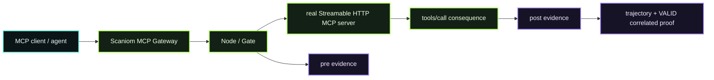

# D07 — MCP Gateway

> **D07 · MCP GATEWAY** · **PUBLIC / NATIVE SCANIOM FIRST** · `run.sh = INTERNAL / ACCEPTANCE ONLY`



### Use your own Scaniom names

```bash
export YOUR_WORKLOAD="customer-agent"          # example only
export YOUR_MCP_SERVER_ID="internal-tools"     # example only
export YOUR_MCP_SERVER_URL="https://mcp.example/mcp"
export YOUR_MCP_TOOL="lookup_customer"
```

Find the real selected workload with `scaniom workload list`. Open Immune does not pre-create the names above.

## Public / native Scaniom flow

D07 places Scaniom between a real MCP client/agent and a **real Streamable HTTP MCP** server. Gate executes **before** `tools/call`; when dispatch succeeds, the gateway records the matching post observation so the accepted evidence path is **pre + post**.

```text
MCP client
   ↓
Scaniom MCP Gateway
   ↓
Node / Gate ── pre evidence
   ↓ PASS only
real MCP server
   ↓
tools/call consequence
   ↓
post observe ── trajectory ── correlated proof
```

1. Verify the real operator/workload scope.
2. Create/reuse explicit MCP-scoped runtime identity while Control is online.
3. Start the released MCP Gateway in front of the real Streamable HTTP MCP server.
4. Point the MCP client at the gateway, not directly at the server.
5. Execute one harmless real `tools/call`.
6. Verify `mcp_gateway` pre + post evidence and the signed correlated proof.

```bash
scaniom workload use "$YOUR_WORKLOAD"
scaniom runtime identity bootstrap --workload "$YOUR_WORKLOAD" --attachments mcp
scaniom runtime identity status --workload "$YOUR_WORKLOAD"

scaniom attach mcp \
  --workload "$YOUR_WORKLOAD" \
  --server-id "$YOUR_MCP_SERVER_ID" \
  --endpoint "$YOUR_MCP_SERVER_URL" \
  --port 8793 \
  --run

# Use the real MCP-scoped scn_ri_v1 runtime token in the deployment/runtime secret boundary.
SCANIOM_RUNTIME_TOKEN="$YOUR_MCP_RUNTIME_TOKEN" \
scaniom attach test mcp \
  --workload "$YOUR_WORKLOAD" \
  --gateway-url http://127.0.0.1:8793 \
  --tool "$YOUR_MCP_TOOL" \
  --args '{}'

scaniom attach status --workload "$YOUR_WORKLOAD"
scaniom trajectory list --limit 100
scaniom proof correlated list --limit 50
```

The gateway preserves workload, server, session, tool, and argument lineage. It does not blindly replay an ambiguous tool dispatch.

## Completion

D07 closes only from selected-workload `mcp_gateway` **pre + post** evidence for the real `tools/call` plus a valid MCP correlated proof. Configuration alone, a diagram, or a synthetic UI state cannot close D07.

## Internal / engineering acceptance

The internal harness exercises the same released Scaniom contracts and verifies runtime-token scope, privacy-minimized correlation identity, real MCP consequence dispatch, pre/post evidence, and signed proof.

```bash
SCANIOM_MCP_SERVER_ID="$YOUR_MCP_SERVER_ID" \
SCANIOM_MCP_ENDPOINT="$YOUR_MCP_SERVER_URL" \
SCANIOM_RUNTIME_TOKEN="$YOUR_MCP_RUNTIME_TOKEN" \
bash demos/d07-mcp-gateway/run.sh
```

Normal Open Immune users do not run this harness.
