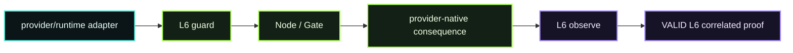

# D08 — L6 Provider Native

> **D08 · L6 PROVIDER NATIVE** · **PUBLIC / NATIVE SCANIOM FIRST** · `run.sh = INTERNAL / ACCEPTANCE ONLY`



D08 proves the released Scaniom 0.4.2 **generic provider-native framework** without pretending Scaniom ships undocumented or privileged vendor hooks.

### Use your own Scaniom names

```bash
export YOUR_WORKLOAD="customer-agent"        # example only
export YOUR_PROVIDER="custom"                # your provider/runtime family
export YOUR_L6_ADAPTER="my-adapter"          # your legitimate adapter identity
export YOUR_L6_HOOK="custom"
export YOUR_L6_EVENT="inference"
```

## Public / native Scaniom flow

1. Select the real environment/workload.
2. Verify the real Node and environment policy.
3. Create/reuse explicit `l6`-scoped `scn_ri_v1` runtime identity.
4. Register the legitimate provider/runtime adapter identity.
5. Run the L6 bridge at the adapter boundary.
6. The adapter sends metadata/capabilities/targets plus an optional SHA-256 context digest to `/v1/guard`.
7. Only when Gate permits, the adapter performs its provider/runtime-specific consequence.
8. The adapter sends `/v1/observe` with the pre-behavior parent and outcome.
9. Verify `provider_native` **pre + post** trajectory and a **VALID L6 correlated proof**.

```bash
scaniom workload use "$YOUR_WORKLOAD"
scaniom runtime identity bootstrap --workload "$YOUR_WORKLOAD" --attachments l6
scaniom runtime identity status --workload "$YOUR_WORKLOAD"

scaniom attach l6 \
  --workload "$YOUR_WORKLOAD" \
  --provider "$YOUR_PROVIDER" \
  --adapter "$YOUR_L6_ADAPTER" \
  --hook "$YOUR_L6_HOOK" \
  --port 8794 \
  --run

SCANIOM_RUNTIME_TOKEN="$YOUR_L6_RUNTIME_TOKEN" \
scaniom attach test l6 \
  --workload "$YOUR_WORKLOAD" \
  --provider "$YOUR_PROVIDER" \
  --adapter "$YOUR_L6_ADAPTER" \
  --event "$YOUR_L6_EVENT"

scaniom attach status --workload "$YOUR_WORKLOAD"
scaniom trajectory list --limit 100
scaniom proof correlated list --limit 50
```

`scaniom attach test l6` is a useful released connectivity check, but it intentionally performs a **synthetic guard only**. It does not execute a provider consequence and does not fabricate post-observe evidence, so that command alone **cannot close D08**.

L6 sends metadata/digests rather than raw prompt/content across the generic provider-native guard boundary. Vendor-specific privileged adapters remain separate integrations; the generic L6 framework does not claim undocumented provider privileges or replace provider-specific validation.

## Completion

D08 closes only after the real adapter performs an allowed consequence and Scaniom records selected-workload `provider_native` **pre + post** evidence plus a **VALID L6 correlated proof**.

Normal Open Immune users do not run this harness.

## Internal / engineering acceptance

`run.sh` is the engineering/reference acceptance harness, not the public Lab workflow. It uses the installed source-independent Scaniom 0.4.2 CLI and a harmless custom provider-native reference adapter.

The reference adapter's real consequence is an append-only local audit record under `.demo/d08/`. Raw prompt/content is neither sent to the generic L6 bridge nor persisted in that ledger. The generic bridge never owns/retries the provider consequence.

```bash
SCANIOM_L6_PROVIDER="$YOUR_PROVIDER" \
SCANIOM_L6_ADAPTER="$YOUR_L6_ADAPTER" \
SCANIOM_RUNTIME_TOKEN="$YOUR_L6_RUNTIME_TOKEN" \
bash demos/d08-l6-provider-native/run.sh
```
