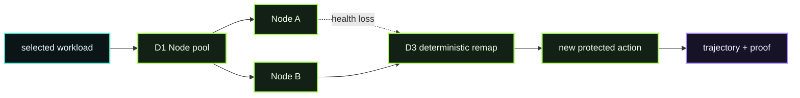

# D09 — Fleet + Failover

> **D09 · FLEET + FAILOVER** · **PUBLIC / NATIVE SCANIOM FIRST** · `run.sh = INTERNAL / ACCEPTANCE ONLY`



D09 proves the R18 D1/D2/D3 fabric as a real runtime system, not as a diagram. The smallest useful redundant topology is **two real Scaniom Nodes**. Production pools may contain more.

### Use your own Scaniom names

```bash
export YOUR_ENVIRONMENT="production"       # example only
export YOUR_WORKLOAD="customer-agent"      # example only
export YOUR_POOL="prod-pool"               # choose your pool name
export YOUR_NODE_PREFIX="prod-node"        # choose your Node prefix
```

Use `scaniom node list` to discover the Node identities you actually enrolled.

## Public / native Scaniom flow

```text
D1 persisted Node pool
        ↓
D2 workload → pool binding
        ↓
Control D3 health/routing authority
        ↓
deterministic selected member
        ↓
protected action #1
        ↓
selected member becomes unavailable before next dispatch
        ↓
pre-dispatch health-aware remap
        ↓
protected action #2 executes once on surviving member
        ↓
trajectory + proof + restoration
```

R18 D3 failover is **pre-dispatch**. It never blindly replays a provider-executing POST after an ambiguous transport failure.

Accepted retry policy:

`pre_dispatch_health_failover_no_ambiguous_replay`

Scaniom 0.4.2 has two related deterministic surfaces:

- **Control D3** ranks persisted Node identities.
- Released SDK/gateways rank configured **runtime URLs** and probe health before dispatch.

Both use the weighted-rendezvous/FNV routing family. Open Immune proves both surfaces directly instead of falsely claiming Node-ID and runtime-URL rankings are always identical for one literal route key.

### Build the real pool

```bash
scaniom fabric add nodes \
  --env "$YOUR_ENVIRONMENT" \
  --prefix "$YOUR_NODE_PREFIX" \
  --count 2

scaniom node list
scaniom node health

# After the printed Node start/enrollment steps, use the real IDs from scaniom node list.
export YOUR_NODE_IDS="node-id-a,node-id-b"

scaniom fabric pool create \
  --env "$YOUR_ENVIRONMENT" \
  --name "$YOUR_POOL" \
  --desired 2 \
  --min 1 \
  --max 2 \
  --capabilities l1,l2,l4 \
  --nodes "$YOUR_NODE_IDS"

scaniom fabric pool members \
  --env "$YOUR_ENVIRONMENT" \
  --pool "$YOUR_POOL" \
  --nodes "$YOUR_NODE_IDS"

scaniom fabric workload pools \
  --workload "$YOUR_WORKLOAD" \
  --pools "$YOUR_POOL"

scaniom fabric routing preview \
  --workload "$YOUR_WORKLOAD" \
  --key "$YOUR_SESSION_KEY"
```

Then execute one protected action through the selected healthy Node, make only the D09-owned selected member unavailable, verify health loss and deterministic remap, execute the next logical action **once** through the surviving member, inspect evidence/proof, and restore the same failed Node.

D09 deliberately does not require a provider key: fleet/failover is a Node-routing property and can be proved with a harmless L2 semantic consequence.

## Completion

D09 is scope-bound to the selected environment, workload, and pool. It requires D1 pool state, D2 workload binding, D3 health/routing/failover, exactly-once protected consequences, one before/after correlated trajectory/proof, and restored redundancy. A receipt for another workload cannot close D09.

Normal Open Immune users do not run this harness.

## Internal / engineering acceptance

`run.sh` is the reference acceptance harness, not the public user experience. It preserves the existing primary Node, creates/reuses a D09-owned secondary, proves failover/no replay, and restores that same secondary before exit.

```bash
bash demos/d09-fleet-failover/run.sh
```
