# D10 - Full Seven-Boundary Offline Continuity

> **D10 · OFFLINE CONTINUITY** · **PUBLIC / NATIVE SCANIOM FIRST** · `run.sh = INTERNAL / ACCEPTANCE ONLY`

```mermaid
flowchart LR
    B["L1 · L2 · L3 · L4 · L5 · MCP · L6"] --> NODE["same Node"] --> CTRL["Control online"]
    CTRL -. path loss .-> OFF["OFFLINE-PROTECTED"]
    OFF --> SPOOL["local evidence spool"] --> RECON["reconnect + replay"] --> P["7 proofs"]
    classDef immune fill:#132015,stroke:#a9ff54,color:#f0ffe6,stroke-width:2px;
    classDef oii fill:#0b1416,stroke:#55e6d2,color:#eafffb,stroke-width:2px;
    classDef evidence fill:#171326,stroke:#a88cff,color:#f2edff,stroke-width:2px;
    class B,NODE,CTRL,OFF immune;
    class SPOOL,RECON,P evidence;
```



### Use your own Scaniom names

Commands shown in Workbench resolve the selected real environment/workload/Node. Names such as `scaniom-demo-agent`, `prod-ai-01`, or `open-immune-node` are examples only. Check your own state with:

```bash
scaniom env list
scaniom workload list
scaniom node list
```

**Public path:** learn and operate B2 using real Scaniom surfaces. Normal users do not run this directory's shell harness.

## What D10 proves

The accepted D10 contract covers **L1, L2, L3, L4, L5, MCP, and L6**, not a representative L2-only test.

```text
Control online -> signed B2 + all required authority -> 7 online actions
       |
       X Node-to-Control transport only
       |
OFFLINE-PROTECTED -> 7 offline actions -> local evidence spool
       |
new bootstrap / unknown authority denied
       |
restore exact path -> no Node/boundary restart -> ordered replay
       |
7 E1 trajectories -> 7 VALID E2 proofs
```

## Public / native Scaniom flow

1. Build the boundaries using D02-D08 native instructions.
2. While Control is online, issue the identity scope required by the full test:

```bash
scaniom runtime identity bootstrap --workload "$YOUR_WORKLOAD" --attachments l1,l2,l3,l4,l5,mcp,l6
scaniom runtime identity status --workload "$YOUR_WORKLOAD"
scaniom runtime continuity --env "$YOUR_ENVIRONMENT"
scaniom node health
```

3. Execute one online action through each active boundary and confirm trajectory/proof.
4. At the real VM/container/Kubernetes/VPC network boundary, remove only **Node -> Control** reachability. Keep the Scaniom Node, workload, upstream provider/runtime/tool targets, and attachment processes alive.
5. Confirm the Node reports `OFFLINE-PROTECTED` locally.
6. Execute one protected action through each boundary using already-known authority. Do not mint new authority offline.
7. Confirm offline evidence is buffered locally and absent from Control.
8. Restore the exact same Control path without restarting the protected execution plane.
9. Confirm spool drain, ordered/idempotent replay, trajectory convergence, and proof revisions.

Accepted bounds: 4h last-known-good window, 30m credential grace, 256 MiB evidence spool, unknown authority denied, bootstrap offline denied, replay required. The 4h expiry is recorded, not simulated with clock manipulation.

### Boundary semantics and real time

L1 and L4 use the real provider-proxy runtime semantics; L2 uses SDK guard execution; L3 uses `runtime_hook`; L5 uses the environment gateway; MCP uses the MCP gateway; and L6 uses the provider-native guard/observe framework. The internal acceptance target is deterministic, but Scaniom authority, Gate decisions, evidence, correlation, replay, and proofs remain real.

D10 does **not** wait four hours during acceptance. It verifies the signed four-hour last-known-good expiry bound carried by the real B2 authority. It does not fast-forward, edit Node state, or simulate lease-expiry exhaustion.

## Completion

Full D10 requires seven attachment-specific trajectories and seven VALID correlated proofs. The accepted full run produces 14 unique consequences - seven online + seven offline - with no execution replay.

## Internal / engineering acceptance

The internal harness automates the real transport cut with a D10-owned transparent loopback relay and deterministic local consequence target. Those components are transport/test fixtures only; they never mint Scaniom authority.

```bash
export SCANIOM_CLI_BIN="$HOME/.local/lib/scaniom/0.4.2/bin/scaniom"
export SCANIOM_NODE_URL="http://127.0.0.1:8787"
bash demos/d10-offline-continuity/run.sh
```

Expected closeout: `OPEN IMMUNE · D10 FULL SEVEN-BOUNDARY OFFLINE CONTINUITY PASS`.
