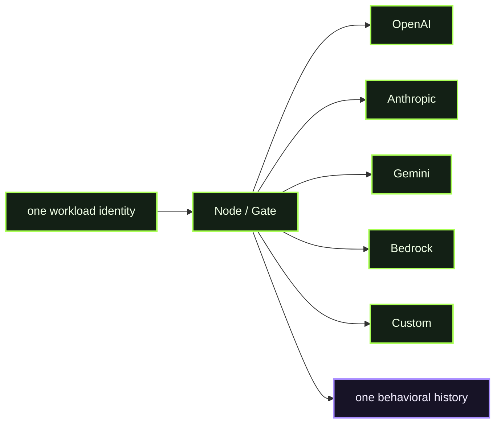

# D11 - Multi-provider

> **D11 · MULTI-PROVIDER** · **PUBLIC / NATIVE SCANIOM FIRST** · `run.sh = INTERNAL / ACCEPTANCE ONLY`



### Use your own Scaniom names

Commands shown in Workbench resolve the selected real environment/workload/Node. Names such as `scaniom-demo-agent`, `prod-ai-01`, or `open-immune-node` are examples only. Check your own state with:

```bash
scaniom env list
scaniom workload list
scaniom node list
```

**Public path:** use one Scaniom workload identity, policy, Gate, and history across multiple real provider routes. Normal users do not run this directory's shell harness.

## Public / native Scaniom flow

Configure at least two real routes:

```bash
scaniom provider add openai --node "$YOUR_NODE_NAME" --workload "$YOUR_WORKLOAD" --model "$YOUR_MODEL"
scaniom secret configure OPENAI_API_KEY --node "$YOUR_NODE_NAME"
scaniom provider add anthropic --node "$YOUR_NODE_NAME" --workload "$YOUR_WORKLOAD" --model "$YOUR_MODEL"
scaniom secret configure ANTHROPIC_API_KEY --node "$YOUR_NODE_NAME"
# Gemini / Bedrock / custom can be added with the same provider catalog workflow.
scaniom node restart
scaniom providers
scaniom provider list
```

Execute real harmless requests against the configured routes, preserving the same workload identity and environment policy.

## Completion

```bash
scaniom trajectory list --limit 100
scaniom proof correlated list --limit 50
```

D11 verifies multiple ready providers for one selected workload and provider-neutral trajectory/proof authority.

## Internal / engineering acceptance

```bash
SCANIOM_MULTI_PROVIDERS=openai,anthropic bash demos/d11-multi-provider/run.sh
```
