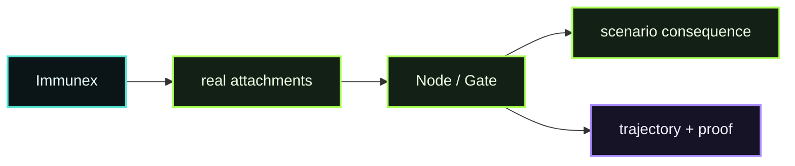

# D12 - Immunex

> **D12 · IMMUNEX** · **PUBLIC / NATIVE SCANIOM FIRST** · `run.sh = INTERNAL / ACCEPTANCE ONLY`



### Use your own Scaniom names

Commands shown in Workbench resolve the selected real environment/workload/Node. Names such as `scaniom-demo-agent`, `prod-ai-01`, or `open-immune-node` are examples only. Check your own state with:

```bash
scaniom env list
scaniom workload list
scaniom node list
```

**Public path:** run repeatable normal/adversarial behavioral evaluation against the real Scaniom Runtime. Normal users do not run this directory's shell harness.

## Public / native Scaniom flow

Use a real selected workload and real provider connection:

```bash
scaniom immunex library
scaniom immunex preflight --workload "$YOUR_WORKLOAD" --connection "$YOUR_CONNECTION_ID" --model "$YOUR_MODEL"
scaniom immunex templates
scaniom immunex blueprint list
scaniom immunex run --workload "$YOUR_WORKLOAD" --connection "$YOUR_CONNECTION_ID" --model "$YOUR_MODEL" --attachments l1,l2,l4 --scenario-set core
```

Immunex evaluates real Scaniom decisions and evidence. Destructive consequential actions remain intentionally inert/sandboxed unless a separately isolated executor is explicitly introduced.

## Completion

Inspect live decisions, trajectory, and proof generated by the campaign.

```bash
scaniom live --env "$YOUR_ENVIRONMENT" --limit 20
scaniom trajectory list --limit 100
scaniom proof correlated list --limit 50
```

## Internal / engineering acceptance

```bash
SCANIOM_CONNECTION_ID="$YOUR_CONNECTION_ID" bash demos/d12-immunex/run.sh
```
