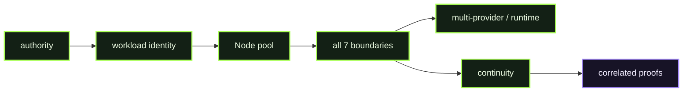

# Flagship - Full Immune Fabric

> **FLAGSHIP · FULL IMMUNE FABRIC** · **PUBLIC / NATIVE SCANIOM FIRST** · `run.sh = INTERNAL / ACCEPTANCE ONLY`



### Use your own Scaniom names

Commands shown in Workbench resolve the selected real environment/workload/Node. Names such as `scaniom-demo-agent`, `prod-ai-01`, or `open-immune-node` are examples only. Check your own state with:

```bash
scaniom env list
scaniom workload list
scaniom node list
```

**Public path:** compose the real Scaniom system; do not use a shortcut script as the customer experience. Normal users do not run this directory's shell harness.

## Public / native Scaniom flow

Build D02-D12 against one coherent protected workload/fabric:

```text
Control / OIS Auth
   -> environment + workload + Address
   -> Node pool + policy + routing
   -> provider routes / runtime targets
   -> L1 + L2 + L3 + L4 + L5 + MCP + L6
   -> multi-provider
   -> failover
   -> offline continuity
   -> Immunex
   -> behavior / trajectory / proof / authority
```

Use each Lab's native commands in the Workbench. Finish with:

```bash
scaniom attach status --workload "$YOUR_WORKLOAD"
scaniom fleet --env "$YOUR_ENVIRONMENT"
scaniom trajectory list --limit 100
scaniom proof correlated list --limit 50
scaniom authority --category all --limit 30
```

## Completion

The Flagship closes only when the real selected fabric exposes all seven accepted boundaries and the required evidence/proof authority. It does not invent state to make the diagram green.

## Internal / engineering acceptance

The harness is a visibility/verifier stage after the focused Labs have already produced real evidence:

```bash
bash demos/flagship-full-fabric/run.sh
```
