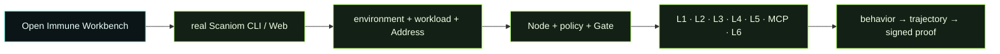

# Open Immune Public Experience Runbook

**Audience:** developers, AI integrators, security teams, platform teams, operators, founders, evaluators.

**Rule:** the public Open Immune experience is the real Scaniom product workflow. Public users do not run repository shell harnesses. The user works through Open Immune Workbench, the installed released `scaniom` CLI, Scaniom Control, the public SDKs, and the runtime boundary that belongs in the user's actual system.

## The public contract




**OPEN IMMUNE PUBLIC PATH** - every step above is real Scaniom authority or evidence.


```text
Open Immune Workbench
        |
        | teaches / resolves / visualizes
        v
real Scaniom operator authority
        |
        +-- Control profile + OIS Auth
        +-- organization / environment / workload
        +-- Scaniom Address / runtime identity
        +-- Node / pool / policy / routing
        +-- L1 / L2 / L3 / L4 / L5 / MCP / L6
        +-- provider BYOK / runtime target
        +-- behavior / trajectory / signed proof
```

Open Immune does not mint a second identity, policy, Gate, runtime token, provider key, trajectory, or proof. Green/DONE must come from live Scaniom state or accepted credential-free local execution evidence where a public distribution check cannot be represented by Control state.

## 1. Install the standalone CLI and verify the release

The public experience begins with the released standalone Scaniom CLI, not a source checkout.

Open Immune does **not** ship or wrap a private Scaniom CLI. Install the released standalone R18 / 0.4.2 bundle first, then Open Immune uses that real `scaniom` command.

### macOS / Linux - verified standalone install

```bash
SCANIOM_VERSION="0.4.2"

case "$(uname -s)" in
  Darwin) SCANIOM_OS="darwin" ;;
  Linux)  SCANIOM_OS="linux" ;;
  *) echo "Unsupported OS for this shell installer: $(uname -s)" >&2; exit 1 ;;
esac

case "$(uname -m)" in
  arm64|aarch64) SCANIOM_ARCH="arm64" ;;
  x86_64)
    if [ "$SCANIOM_OS" = "darwin" ]; then SCANIOM_ARCH="x64"; else SCANIOM_ARCH="amd64"; fi
    ;;
  *) echo "Unsupported architecture: $(uname -m)" >&2; exit 1 ;;
esac

SCANIOM_TARGET="$SCANIOM_OS-$SCANIOM_ARCH"
SCANIOM_ASSET="r18-standalone-$SCANIOM_TARGET.tar.gz"
SCANIOM_RELEASE="https://github.com/faradeen-ja/scaniom-releases/releases/download/v$SCANIOM_VERSION"
SCANIOM_INSTALL_ROOT="$HOME/.local/lib/scaniom/$SCANIOM_VERSION"
SCANIOM_TMP="$(mktemp -d)"
trap 'rm -rf "$SCANIOM_TMP"' EXIT

curl -fL "$SCANIOM_RELEASE/$SCANIOM_ASSET" -o "$SCANIOM_TMP/$SCANIOM_ASSET"
curl -fL "$SCANIOM_RELEASE/SHA256SUMS" -o "$SCANIOM_TMP/SHA256SUMS"

(
  cd "$SCANIOM_TMP"
  if command -v sha256sum >/dev/null 2>&1; then
    grep "  $SCANIOM_ASSET$" SHA256SUMS | sha256sum -c -
  else
    grep "  $SCANIOM_ASSET$" SHA256SUMS | shasum -a 256 -c -
  fi
)

mkdir -p "$SCANIOM_INSTALL_ROOT" "$HOME/.local/bin"
tar -xzf "$SCANIOM_TMP/$SCANIOM_ASSET" -C "$SCANIOM_INSTALL_ROOT"
ln -sfn "$SCANIOM_INSTALL_ROOT/bin/scaniom" "$HOME/.local/bin/scaniom"
ln -sfn "$SCANIOM_INSTALL_ROOT/bin/scaniom-node" "$HOME/.local/bin/scaniom-node"

case "${SHELL:-}" in
  */zsh)  SCANIOM_SHELL_PROFILE="$HOME/.zshrc" ;;
  */bash) SCANIOM_SHELL_PROFILE="$HOME/.bashrc" ;;
  *)      SCANIOM_SHELL_PROFILE="$HOME/.profile" ;;
esac

touch "$SCANIOM_SHELL_PROFILE"
grep -Fq 'export PATH="$HOME/.local/bin:$PATH"' "$SCANIOM_SHELL_PROFILE" || \
  printf '\nexport PATH="$HOME/.local/bin:$PATH"\n' >> "$SCANIOM_SHELL_PROFILE"
export PATH="$HOME/.local/bin:$PATH"

scaniom version --json
scaniom artifacts supply-chain
```

<details>
<summary><strong>Windows x64 - PowerShell</strong></summary>

```powershell
$Version = "0.4.2"
$Asset = "r18-standalone-windows-x64.tar.gz"
$Base = "https://github.com/faradeen-ja/scaniom-releases/releases/download/v$Version"
$Install = Join-Path $HOME ".local\lib\scaniom\$Version"
$Tmp = Join-Path $env:TEMP "scaniom-$Version"
New-Item -ItemType Directory -Force -Path $Tmp, $Install | Out-Null

Invoke-WebRequest "$Base/$Asset" -OutFile (Join-Path $Tmp $Asset)
Invoke-WebRequest "$Base/SHA256SUMS" -OutFile (Join-Path $Tmp "SHA256SUMS")

$Expected = ((Get-Content (Join-Path $Tmp "SHA256SUMS") | Select-String " $Asset$").Line -split "\\s+")[0].ToLower()
$Actual = (Get-FileHash (Join-Path $Tmp $Asset) -Algorithm SHA256).Hash.ToLower()
if ($Actual -ne $Expected) { throw "Scaniom archive SHA-256 verification failed" }

tar.exe -xzf (Join-Path $Tmp $Asset) -C $Install
$Bin = Join-Path $Install "bin"
$UserPath = [Environment]::GetEnvironmentVariable("Path", "User")
if (($UserPath -split ";") -notcontains $Bin) {
  [Environment]::SetEnvironmentVariable("Path", "$Bin;$UserPath", "User")
}

& (Join-Path $Bin "scaniom.cmd") version --json
```

Open a new PowerShell after changing the user PATH.
</details>

> The standalone archive includes the Scaniom CLI, Node launcher, bundled Node runtime, and the released L3/L4/L5/MCP/L6 runtime programs. A Scaniom source checkout and a system Node.js installation are not prerequisites for the standalone CLI.

After installation:

```bash
scaniom version --json
scaniom artifacts supply-chain
scaniom profile test cloud
```

L2 only:

```bash
npm install @scaniom/sdk@0.4.2
# or
python3 -m pip install scaniom==0.4.2
```

The SDK is not an L1 prerequisite.

## 2. OIS Auth - same Control, separate approved sessions

```bash
scaniom profile use cloud
scaniom profile test cloud
scaniom login
scaniom whoami
scaniom auth status
```

Then connect Open Immune at `http://localhost:3000/workspace`. Browser and CLI credentials stay separate. The parity proof is the same selected Scaniom Control and the same authorized organization/runtime objects, not token sharing.

## Your names, not our demo names

Scaniom does not require names such as `production`, `customer-agent`, or `prod-ai-01`. Those are examples only. **Use names that belong to your environment.**

Set your values once before following the examples:

```bash
export YOUR_ENVIRONMENT="production"          # choose your environment name
export YOUR_WORKLOAD="customer-agent"        # choose your workload name / slug
export YOUR_NODE_NAME="prod-ai-01"           # choose your Node name
export YOUR_MODEL="gpt-5-mini"               # choose the model for your real route
```

| Value used in this README | What it means | Example only | Find your existing value |
| --- | --- | --- | --- |
| `$YOUR_ENVIRONMENT` | protected Scaniom environment | `production` | `scaniom env list` |
| `$YOUR_WORKLOAD` | protected workload name/slug | `customer-agent` | `scaniom workload list` |
| `$YOUR_NODE_NAME` | **your enrolled Node name** | `prod-ai-01` | `scaniom node list` |
| `$YOUR_MODEL` | model used by your route/runtime | `gpt-5-mini` | `scaniom provider list` / your runtime |

Example:

```bash
scaniom node enroll "$YOUR_NODE_NAME" --env "$YOUR_ENVIRONMENT" --background

scaniom provider add openai \
  --node "$YOUR_NODE_NAME" \
  --workload "$YOUR_WORKLOAD" \
  --model "$YOUR_MODEL"
```

`prod-ai-01` above is **not pre-created by Open Immune**. It is simply an example value for `$YOUR_NODE_NAME`. If you already enrolled a Node, use the name shown by `scaniom node list`.

## 3. Create the real protected scope

```bash
scaniom env create "$YOUR_ENVIRONMENT" --type production
scaniom workload create "$YOUR_WORKLOAD" --env "$YOUR_ENVIRONMENT" --kind application
scaniom workload use "$YOUR_WORKLOAD"
scaniom address issue --workload "$YOUR_WORKLOAD" --ttl 24
```

Bring machine authority online and publish policy:

```bash
scaniom node enroll "$YOUR_NODE_NAME" --env "$YOUR_ENVIRONMENT" --background
scaniom node list
scaniom node health
scaniom node doctor
scaniom policy set --env "$YOUR_ENVIRONMENT" --mode enforce
scaniom policy list
```

## 4. Provider BYOK stays at the Node/runtime boundary

Open Immune never asks for raw provider keys. Scaniom Control stores route metadata and secret references; the Node, platform identity, or enterprise secret system owns the credential value.

```bash
scaniom provider catalog

scaniom provider add openai --node "$YOUR_NODE_NAME" --workload "$YOUR_WORKLOAD" --model "$YOUR_MODEL"
scaniom secret configure OPENAI_API_KEY --node "$YOUR_NODE_NAME"

scaniom provider add anthropic --node "$YOUR_NODE_NAME" --workload "$YOUR_WORKLOAD" --model "$YOUR_MODEL"
scaniom secret configure ANTHROPIC_API_KEY --node "$YOUR_NODE_NAME"

scaniom provider add gemini --node "$YOUR_NODE_NAME" --workload "$YOUR_WORKLOAD" --model "$YOUR_MODEL"
scaniom secret configure GEMINI_API_KEY --node "$YOUR_NODE_NAME"

scaniom provider add bedrock --node "$YOUR_NODE_NAME" --workload "$YOUR_WORKLOAD" --model "$YOUR_MODEL" --region "$YOUR_AWS_REGION"
# Prefer AWS workload identity/role. Use Node-local secret material only when appropriate.

scaniom provider add custom --node "$YOUR_NODE_NAME" --workload "$YOUR_WORKLOAD" --endpoint "$YOUR_PROVIDER_ENDPOINT" --model "$YOUR_MODEL" --secret-env CUSTOM_MODEL_TOKEN
scaniom secret configure CUSTOM_MODEL_TOKEN --node "$YOUR_NODE_NAME"

scaniom node restart
scaniom providers
scaniom provider list
```

## 5. Seven execution boundaries

| Boundary | Where it belongs | Identity scope | Native entry | Evidence source | User learns |
| --- | --- | --- | --- | --- | --- |
| L1 API Route | app/provider API path | `l1` | `/v1/responses`, `scaniom attach l1` | `provider_proxy` | provider API traffic through Gate |
| L2 SDK | application/agent code | shared B1 `l1,l2,l4` | `@scaniom/sdk`, `scaniom` PyPI | `sdk` | semantic actions before/after consequence |
| L3 Model Runtime | vLLM/NIM/Triton/compatible runtime | explicit `l3` | runtime adapter | `runtime_hook` | Gate before inference |
| L4 Sidecar | beside workload | shared B1 `l1,l2,l4` | sidecar | `sidecar` | protect existing app with minimal call-site change |
| L5 Environment Gateway | cluster/VPC/private ingress | explicit `l5` | environment gateway | `gateway` | shared ingress without shared identity |
| MCP Gateway | between MCP client and server | explicit `mcp` | Streamable HTTP gateway | `mcp_gateway` | Gate before `tools/call` consequence |
| L6 Provider Native | provider/runtime-native adapter | explicit `l6` | guard/observe bridge | `provider_native` | Gate immediately before privileged native consequence |

### L1

```bash
scaniom attach l1 --workload "$YOUR_WORKLOAD" --node "$YOUR_NODE_NAME" --preset openai --model "$YOUR_MODEL"
scaniom runtime identity bootstrap --workload "$YOUR_WORKLOAD" --attachments l1
scaniom runtime identity status --workload "$YOUR_WORKLOAD"
scaniom attach test l1 --workload "$YOUR_WORKLOAD" --model "$YOUR_MODEL" -- "Say hello in one sentence"
scaniom attach status --workload "$YOUR_WORKLOAD"
```

### L2

```bash
scaniom attach l2 --workload "$YOUR_WORKLOAD" --lang typescript
scaniom runtime identity bootstrap --workload "$YOUR_WORKLOAD" --attachments l1,l2,l4
scaniom runtime identity status --workload "$YOUR_WORKLOAD"
scaniom attach test l2 --workload "$YOUR_WORKLOAD" --lang typescript --model "$YOUR_MODEL" -- "Say hello"
scaniom attach status --workload "$YOUR_WORKLOAD"
```

### L3

```bash
scaniom attach l3 --workload "$YOUR_WORKLOAD" --kind <vllm|nvidia_nim|triton|openai_compatible> --endpoint "$YOUR_RUNTIME_URL" --run
scaniom runtime identity bootstrap --workload "$YOUR_WORKLOAD" --attachments l3
scaniom attach test l3 --workload "$YOUR_WORKLOAD" --model "$YOUR_MODEL" -- "Say hello"
scaniom attach status --workload "$YOUR_WORKLOAD"
```

### L4

```bash
scaniom attach l4 --workload "$YOUR_WORKLOAD" --port 8790
scaniom runtime identity bootstrap --workload "$YOUR_WORKLOAD" --attachments l1,l2,l4
scaniom attach test l4 --workload "$YOUR_WORKLOAD" --model "$YOUR_MODEL" -- "Say hello"
scaniom attach status --workload "$YOUR_WORKLOAD"
```

### L5

```bash
scaniom attach l5 --environment "$YOUR_ENVIRONMENT" --port 8791 --run
scaniom runtime identity bootstrap --workload "$YOUR_WORKLOAD" --attachments l5
scaniom attach test l5 --workload "$YOUR_WORKLOAD" --model "$YOUR_MODEL" -- "Say hello"
scaniom attach status --workload "$YOUR_WORKLOAD"
```

### MCP

```bash
scaniom attach mcp --workload "$YOUR_WORKLOAD" --server-id internal-tools --endpoint "$YOUR_MCP_SERVER_URL" --port 8793 --run
scaniom runtime identity bootstrap --workload "$YOUR_WORKLOAD" --attachments mcp
SCANIOM_RUNTIME_TOKEN=<mcp-scoped-runtime-token> scaniom attach test mcp --workload "$YOUR_WORKLOAD" --gateway-url http://127.0.0.1:8793 --tool "$YOUR_MCP_TOOL" --args '{}'
scaniom attach status --workload "$YOUR_WORKLOAD"
```

### L6

```bash
scaniom attach l6 --workload "$YOUR_WORKLOAD" --provider <provider> --adapter "$YOUR_L6_ADAPTER" --hook "$YOUR_L6_HOOK" --port 8794 --run
scaniom runtime identity bootstrap --workload "$YOUR_WORKLOAD" --attachments l6
SCANIOM_RUNTIME_TOKEN=<l6-scoped-runtime-token> scaniom attach test l6 --workload "$YOUR_WORKLOAD" --provider <provider> --adapter "$YOUR_L6_ADAPTER" --event "$YOUR_L6_EVENT"
scaniom attach status --workload "$YOUR_WORKLOAD"
```

## 6. Evidence is the end of every Lab

```bash
scaniom attach status --workload "$YOUR_WORKLOAD"
scaniom live --env "$YOUR_ENVIRONMENT" --limit 20
scaniom trajectory list --limit 100
scaniom proof --window 24h --limit 10
scaniom proof correlated list --limit 50
scaniom proof correlated verify <proof-or-correlation>
scaniom explain <behavior-id>
scaniom verify <receipt-or-behavior-id>
```

## 7. Founder/customer demo - no repository scripts

```text
1. Open Open Immune
2. OIS Auth
3. Show same Scaniom identity / organization / Control
4. Select a Lab
5. Open Fabric Matrix
6. Run the native Scaniom commands shown by Inspector
7. Watch live objects become verified
8. Cause a real harmless behavior
9. Show the trajectory
10. Verify the signed proof
```

The purpose of the demo is to prove Open Immune is a real engineering experience around Scaniom, not a canned movie or hidden shell routine.

## 8. D10 public offline-continuity experience

D10 teaches the real operational sequence. The user does not run an Open Immune outage script.

```text
Control online
   |
inspect signed continuity authority
   |
establish all runtime identities required by the chosen boundaries
   |
execute normal protected traffic and confirm online evidence
   |
remove only Node -> Control transport at the real deployment/network boundary
   |
confirm OFFLINE-PROTECTED locally
   |
execute protected traffic with already-known authority
   |
new bootstrap/unknown authority remains denied
   |
evidence is buffered locally
   |
restore the exact same Control path
   |
Node reconnects without execution replay
   |
ordered/idempotent evidence replay
   |
trajectory + signed proof
```

For the full R18 fabric exercise, establish the all-seven identity while Control is reachable:

```bash
scaniom runtime identity bootstrap --workload "$YOUR_WORKLOAD" --attachments l1,l2,l3,l4,l5,mcp,l6
scaniom runtime identity status --workload "$YOUR_WORKLOAD"
scaniom runtime continuity --env "$YOUR_ENVIRONMENT"
scaniom node health
```

The signed default limits are bounded last-known-good authority, not disconnected forever authority: 4h maximum offline window, 30m credential stale allowance, 256 MiB evidence spool, unknown authority denied, offline bootstrap denied, replay required.


## System Blueprints are first-class public runbooks

The Web catalog also exposes five composed systems. They are not decorative cards and they are not shell demos. Each has a native Scaniom guide:

- [`AI SaaS Operations Center`](system-blueprints/system-saas.md) — L1 + L2 + MCP
- [`Robot Fleet`](system-blueprints/system-robots.md) — L2 + L4 + L5 + MCP
- [`Autonomous Lanes`](system-blueprints/system-lanes.md) — L1 + L2 + L5 + L6
- [`AI Inference Factory`](system-blueprints/system-factory.md) — L3 + L4 + L5
- [`IFOC — Full Immune Fabric Operations Center`](system-blueprints/system-ifoc.md) — all seven boundaries

Workbench remains the live source for resolved selected-object values and evidence-driven completion.
