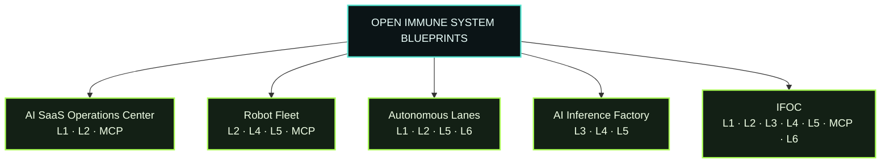

# Open Immune System Blueprints

The Workbench catalog contains five **System Blueprints** in addition to D00-D12 + Flagship. A System Blueprint composes the same native Scaniom attachment boundaries into a realistic system architecture. It is not a second demo engine and it has no public `run.sh` shortcut.

| Blueprint | Boundaries | Composition | Guide |
| --- | --- | --- | --- |
| AI SaaS Operations Center | L1 · L2 · MCP | provider API + semantic agent actions + tools | [`system-saas.md`](system-blueprints/system-saas.md) |
| Robot Fleet | L2 · L4 · L5 · MCP | edge/controller identity + sidecars + ingress + tools | [`system-robots.md`](system-blueprints/system-robots.md) |
| Autonomous Lanes | L1 · L2 · L5 · L6 | API/semantic control + environment ingress + privileged consequence edge | [`system-lanes.md`](system-blueprints/system-lanes.md) |
| AI Inference Factory | L3 · L4 · L5 | GPU/model runtime + sidecar + environment ingress | [`system-factory.md`](system-blueprints/system-factory.md) |
| IFOC — Full Immune Fabric Operations Center | all seven | multi-Node + multi-provider + continuity + proof | [`system-ifoc.md`](system-blueprints/system-ifoc.md) |

## Public operating rule

The System Blueprint uses the same selected Scaniom account, organization, environment, workload, Nodes, runtime identities, policy, BYOK, trajectories and proofs as the focused Labs. Workbench Inspector shows the manifest-owned steps and real commands. Completion remains evidence-driven.

## Internal acceptance rule

There is intentionally no `demos/system-*/run.sh`. Internal assurance comes from the focused D00-D12 acceptance harnesses, Flagship visibility, manifest/UI regressions, and full local acceptance. This prevents System Blueprints from becoming a parallel synthetic execution system.
