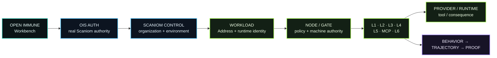
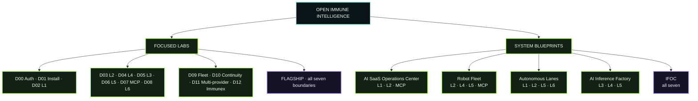

# Open Immune Intelligence

**Public engineering Labs for building real Scaniom Immune Fabric from zero to verifiable runtime evidence.**

<div align="center">

### ◉ OPEN IMMUNE INTELLIGENCE
**Build real Scaniom Immune Fabric. Learn it on the same surfaces you operate.**

`SCANIOM R18 / 0.4.2` · `REAL CONTROL` · `7 EXECUTABLE BOUNDARIES` · `SIGNED EVIDENCE`

</div>

```text
     ╭────────────────────────────────────────────────────────────╮
  ●──╯    OPEN IMMUNE  ×  SCANIOM IMMUNE FABRIC          ◉       ╰──●
     ╰────────────────────────────────────────────────────────────╯
```


| START | BUILD | PROVE | ENGINEERING |
| --- | --- | --- | --- |
| **OIS Auth** · connect the real Scaniom account | **Workbench** · follow native CLI/SDK/runtime steps | **Intelligence** · inspect behavior, trajectory and proof | **Acceptance** · `demos/dXX/run.sh` is maintainer/CI only |
| `http://localhost:3000/workspace` | `http://localhost:3000/workbench` | real Scaniom evidence | never the public learning path |

Open Immune Intelligence (OII) is not a simulation of Scaniom and is not a second security product. It is the public engineering experience around released Scaniom artifacts. You choose a Lab or system, connect a real Scaniom account, build the required runtime boundaries in the real place they belong, run real traffic, and inspect the resulting Gate decisions, trajectory and proof.

> **Current public Scaniom release:** R18 / 0.4.2 · `faradeen-ja/scaniom-releases` · public Control `https://control.scaniom.com`

## What is real

```text
Open Immune Intelligence (localhost UI + public lab repo)
        │
        ├─ OIS Auth ───────────────→ real Scaniom Control
        │                              https://control.scaniom.com
        │
        ├─ Labs / system manifests
        │      ↓
        ├─ real CLI / SDK / runtime placement
        │      ↓
        └─ real Scaniom Immune Fabric
               environment
               workload + Scaniom Address
               Node / Node pool
               policy / Gate
               L1 · L2 · L3 · L4 · L5 · MCP · L6
               provider/runtime targets
               behavior · trajectory · proof
```

Open Immune never marks Node, policy, attachment, provider, Gate, trajectory or proof as completed merely because the UI rendered them. Those states require real Scaniom evidence.

---

## Public experience vs internal acceptance

Open Immune has two intentionally different execution lanes that use the same Scaniom contracts:

```text
PUBLIC / HUMAN                         INTERNAL / ENGINEERING
Workbench + Start A-Z                  demos/dXX/run.sh
        |                                      |
real Scaniom Web/CLI/SDK/runtime       same released Scaniom contracts
        |                                      |
live authority + evidence              deterministic acceptance checks
        |                                      |
learn / build / operate                receipt / regression / release gate
```

**Public users do not run repository Lab shell harnesses.** The public experience is OIS Auth, the installed released `scaniom` CLI, real Scaniom Control/Node/SDK/runtime placement, and live behavior/trajectory/proof. Files under `demos/` are internal engineering/CI acceptance harnesses only; they never become another product layer or user-facing API.

Canonical guides:

- `docs/PUBLIC-EXPERIENCE-RUNBOOK.md`
- `docs/LAB-COMMAND-MATRIX.md`
- `docs/BOUNDARY-REFERENCE.md`
- `docs/INTERNAL-ENGINEERING-RUNBOOK.md`
- `docs/OPEN-IMMUNE-END-TO-END-PACKET.md`

## Install the released Scaniom CLI

Open Immune does **not** ship or wrap a private Scaniom CLI. Install the released standalone R18 / 0.4.2 bundle first, then Open Immune uses that real `scaniom` command.

### macOS / Linux - verified standalone install

```bash
SCANIOM_VERSION="0.4.2"

case "$(uname -s)" in
  Darwin) SCANIOM_OS="darwin" ;;
  Linux)  SCANIOM_OS="linux" ;;
  *) echo "Unsupported OS for this shell installer: $(uname -s)" >&2; exit 1 ;;
esac

case "$(uname -m)" in
  arm64|aarch64) SCANIOM_ARCH="arm64" ;;
  x86_64)
    if [ "$SCANIOM_OS" = "darwin" ]; then SCANIOM_ARCH="x64"; else SCANIOM_ARCH="amd64"; fi
    ;;
  *) echo "Unsupported architecture: $(uname -m)" >&2; exit 1 ;;
esac

SCANIOM_TARGET="$SCANIOM_OS-$SCANIOM_ARCH"
SCANIOM_ASSET="r18-standalone-$SCANIOM_TARGET.tar.gz"
SCANIOM_RELEASE="https://github.com/faradeen-ja/scaniom-releases/releases/download/v$SCANIOM_VERSION"
SCANIOM_INSTALL_ROOT="$HOME/.local/lib/scaniom/$SCANIOM_VERSION"
SCANIOM_TMP="$(mktemp -d)"
trap 'rm -rf "$SCANIOM_TMP"' EXIT

curl -fL "$SCANIOM_RELEASE/$SCANIOM_ASSET" -o "$SCANIOM_TMP/$SCANIOM_ASSET"
curl -fL "$SCANIOM_RELEASE/SHA256SUMS" -o "$SCANIOM_TMP/SHA256SUMS"

(
  cd "$SCANIOM_TMP"
  if command -v sha256sum >/dev/null 2>&1; then
    grep "  $SCANIOM_ASSET$" SHA256SUMS | sha256sum -c -
  else
    grep "  $SCANIOM_ASSET$" SHA256SUMS | shasum -a 256 -c -
  fi
)

mkdir -p "$SCANIOM_INSTALL_ROOT" "$HOME/.local/bin"
tar -xzf "$SCANIOM_TMP/$SCANIOM_ASSET" -C "$SCANIOM_INSTALL_ROOT"
ln -sfn "$SCANIOM_INSTALL_ROOT/bin/scaniom" "$HOME/.local/bin/scaniom"
ln -sfn "$SCANIOM_INSTALL_ROOT/bin/scaniom-node" "$HOME/.local/bin/scaniom-node"

case "${SHELL:-}" in
  */zsh)  SCANIOM_SHELL_PROFILE="$HOME/.zshrc" ;;
  */bash) SCANIOM_SHELL_PROFILE="$HOME/.bashrc" ;;
  *)      SCANIOM_SHELL_PROFILE="$HOME/.profile" ;;
esac

touch "$SCANIOM_SHELL_PROFILE"
grep -Fq 'export PATH="$HOME/.local/bin:$PATH"' "$SCANIOM_SHELL_PROFILE" || \
  printf '\nexport PATH="$HOME/.local/bin:$PATH"\n' >> "$SCANIOM_SHELL_PROFILE"
export PATH="$HOME/.local/bin:$PATH"

scaniom version --json
scaniom artifacts supply-chain
```

<details>
<summary><strong>Windows x64 - PowerShell</strong></summary>

```powershell
$Version = "0.4.2"
$Asset = "r18-standalone-windows-x64.tar.gz"
$Base = "https://github.com/faradeen-ja/scaniom-releases/releases/download/v$Version"
$Install = Join-Path $HOME ".local\lib\scaniom\$Version"
$Tmp = Join-Path $env:TEMP "scaniom-$Version"
New-Item -ItemType Directory -Force -Path $Tmp, $Install | Out-Null

Invoke-WebRequest "$Base/$Asset" -OutFile (Join-Path $Tmp $Asset)
Invoke-WebRequest "$Base/SHA256SUMS" -OutFile (Join-Path $Tmp "SHA256SUMS")

$Expected = ((Get-Content (Join-Path $Tmp "SHA256SUMS") | Select-String " $Asset$").Line -split "\\s+")[0].ToLower()
$Actual = (Get-FileHash (Join-Path $Tmp $Asset) -Algorithm SHA256).Hash.ToLower()
if ($Actual -ne $Expected) { throw "Scaniom archive SHA-256 verification failed" }

tar.exe -xzf (Join-Path $Tmp $Asset) -C $Install
$Bin = Join-Path $Install "bin"
$UserPath = [Environment]::GetEnvironmentVariable("Path", "User")
if (($UserPath -split ";") -notcontains $Bin) {
  [Environment]::SetEnvironmentVariable("Path", "$Bin;$UserPath", "User")
}

& (Join-Path $Bin "scaniom.cmd") version --json
```

Open a new PowerShell after changing the user PATH.
</details>

> The standalone archive includes the Scaniom CLI, Node launcher, bundled Node runtime, and the released L3/L4/L5/MCP/L6 runtime programs. A Scaniom source checkout and a system Node.js installation are not prerequisites for the standalone CLI.

# Start A–Z

## A. Clone Open Immune and confirm the public Scaniom release

```bash
git clone https://github.com/faradeen-ja/scaniom-demo.git OPEN-IMMUNE-INTELLIGENCE
cd OPEN-IMMUNE-INTELLIGENCE
npm install
npm run dev
```

Open `http://localhost:3000`. The web release badge reads the latest public `faradeen-ja/scaniom-releases` release and falls back to the accepted R18 / 0.4.2 baseline if GitHub is unavailable. **Release status is informational/readiness metadata; it is not a blocking Lab step.**

The public release includes standalone CLI/runtime archives, SHA256SUMS, Sigstore evidence, publication receipt, provenance and SBOM assets.

## B. Install or verify the released Scaniom CLI

Use the public release artifact for your platform. After the native CLI is on `PATH`, all Lab operator flows use the installed `scaniom` command — not repo-local shell scripts.

```bash
scaniom version
scaniom artifacts supply-chain
scaniom profile test cloud
```

If the CLI is not installed yet, use the current public release link from the Open Immune release badge or the `faradeen-ja/scaniom-releases` release page and install the standalone archive for `darwin-arm64`, `darwin-x64`, `linux-amd64`, `linux-arm64`, or Windows x64. Verify the published SHA256SUMS/Sigstore material before exposing the command on `PATH`.

The TypeScript/Python SDKs are **L2 application dependencies**, not the CLI and not L1 prerequisites. Install only the language used by the real L2 workload:

```bash
npm install @scaniom/sdk@0.4.2
# OR
python3 -m pip install scaniom==0.4.2
```

## C. OIS Auth — Open Immune ↔ Scaniom authorization

The public Cloud Control is the default:

```bash
scaniom profile use cloud
scaniom profile test cloud
scaniom login
scaniom whoami
scaniom auth status
```

Open Immune uses the same Scaniom account through browser-approved device authorization. It does not receive your Scaniom password and does not create a second account database.

Browser routes:

```text
Create account:  https://control.scaniom.com/signup
Control:         https://control.scaniom.com/console
Open Immune:     http://localhost:3000
OIS Auth:        http://localhost:3000/workspace
Labs:            http://localhost:3000/workbench
Start A–Z:       http://localhost:3000/docs
```

For another Control deployment:

```bash
# Self-hosted
scaniom profile add company \
  --control https://control.company.example \
  --type self-hosted
scaniom profile use company
scaniom profile test company
scaniom login

# Private enterprise
scaniom profile add private \
  --control https://control.internal.example \
  --type private-enterprise \
  --ca-file /path/to/company-ca.pem
scaniom profile use private
scaniom profile test private
scaniom login
```

Remote profiles require HTTPS. Local profiles are loopback-only.

## D. Create the protected Scaniom scope

You can create these in Scaniom Control or CLI. The Lab consumes the same objects either way.

```bash
scaniom env create "$YOUR_ENVIRONMENT" --type production

scaniom workload create "$YOUR_WORKLOAD" \
  --env "$YOUR_ENVIRONMENT" \
  --kind application

scaniom workload use "$YOUR_WORKLOAD"
scaniom address issue --workload "$YOUR_WORKLOAD" --ttl 24
```

The **Scaniom Address** is signed workload identity. It is different from the human CLI session and different from the provider API key.

## E. Bring the machine authority online

For a simple Node:

```bash
scaniom node enroll "$YOUR_NODE_NAME" --env "$YOUR_ENVIRONMENT" --background
scaniom node health
scaniom node doctor
```

For a real multi-Node Lab, use the fleet/pool workflow shown by D09 instead of pretending one localhost process represents the deployment.

Then publish policy:

```bash
scaniom policy set --env "$YOUR_ENVIRONMENT" --mode enforce
scaniom policy list
```

The Node remains the machine-speed authority for identity, trajectory, risk, policy and Gate decisions.

---

## Your names, not our demo names

Scaniom does not require names such as `production`, `customer-agent`, or `prod-ai-01`. Those are examples only. **Use names that belong to your environment.**

Set your values once before following the examples:

```bash
export YOUR_ENVIRONMENT="production"          # choose your environment name
export YOUR_WORKLOAD="customer-agent"        # choose your workload name / slug
export YOUR_NODE_NAME="prod-ai-01"           # choose your Node name
export YOUR_MODEL="gpt-5-mini"               # choose the model for your real route
```

| Value used in this README | What it means | Example only | Find your existing value |
| --- | --- | --- | --- |
| `$YOUR_ENVIRONMENT` | protected Scaniom environment | `production` | `scaniom env list` |
| `$YOUR_WORKLOAD` | protected workload name/slug | `customer-agent` | `scaniom workload list` |
| `$YOUR_NODE_NAME` | **your enrolled Node name** | `prod-ai-01` | `scaniom node list` |
| `$YOUR_MODEL` | model used by your route/runtime | `gpt-5-mini` | `scaniom provider list` / your runtime |

Example:

```bash
scaniom node enroll "$YOUR_NODE_NAME" --env "$YOUR_ENVIRONMENT" --background

scaniom provider add openai \
  --node "$YOUR_NODE_NAME" \
  --workload "$YOUR_WORKLOAD" \
  --model "$YOUR_MODEL"
```

`prod-ai-01` above is **not pre-created by Open Immune**. It is simply an example value for `$YOUR_NODE_NAME`. If you already enrolled a Node, use the name shown by `scaniom node list`.

## Complete Open Immune catalog

The public OII catalog has **14 focused Lab/Flagship runbooks plus 5 System Blueprints**. Focused Labs teach one accepted capability at a time; System Blueprints compose those same boundaries into realistic architectures.



### Focused Labs

| Runbook | Purpose | Boundaries |
| --- | --- | --- |
| [D00 · OIS Auth](demos/d00-account-auth/README.md) | Web ↔ Control ↔ CLI authority parity | authority |
| [D01 · Public Install](demos/d01-public-install/README.md) | standalone CLI/runtime + npm/PyPI distribution | release |
| [D02 · L1 Full Cycle](demos/d02-l1-full-cycle/README.md) | provider API route through Gate | L1 |
| [D03 · L2 Agent SDK](demos/d03-l2-agent-sdk/README.md) | semantic guard/consequence/observe | L2 |
| [D04 · L4 Sidecar](demos/d04-l4-sidecar/README.md) | workload-local sidecar placement | L4 |
| [D05 · L3 Model Runtime](demos/d05-l3-model-runtime/README.md) | Gate-before-inference | L3 |
| [D06 · L5 Environment Gateway](demos/d06-l5-environment-gateway/README.md) | attributed environment ingress | L5 |
| [D07 · MCP Gateway](demos/d07-mcp-gateway/README.md) | Gate before real `tools/call` | MCP |
| [D08 · L6 Provider Native](demos/d08-l6-provider-native/README.md) | guard before provider/runtime-native consequence | L6 |
| [D09 · Fleet + Failover](demos/d09-fleet-failover/README.md) | D1/D2/D3 pools, routing, failover | L1 · L2 · L4 fabric |
| [D10 · Offline Continuity](demos/d10-offline-continuity/README.md) | bounded B2 continuity across all seven | all seven |
| [D11 · Multi-provider](demos/d11-multi-provider/README.md) | one workload identity across providers | L1 |
| [D12 · Immunex](demos/d12-immunex/README.md) | repeatable behavior evaluation | L1 · L2 · L4 |
| [FLAGSHIP · Full Immune Fabric](demos/flagship-full-fabric/README.md) | complete composition/visibility | all seven |

### System Blueprints

| Blueprint | Composition | Native guide |
| --- | --- | --- |
| AI SaaS Operations Center | L1 · L2 · MCP | [`system-saas`](docs/system-blueprints/system-saas.md) |
| Robot Fleet | L2 · L4 · L5 · MCP | [`system-robots`](docs/system-blueprints/system-robots.md) |
| Autonomous Lanes | L1 · L2 · L5 · L6 | [`system-lanes`](docs/system-blueprints/system-lanes.md) |
| AI Inference Factory | L3 · L4 · L5 | [`system-factory`](docs/system-blueprints/system-factory.md) |
| IFOC — Full Immune Fabric Operations Center | L1 · L2 · L3 · L4 · L5 · MCP · L6 | [`system-ifoc`](docs/system-blueprints/system-ifoc.md) |

See [`docs/SYSTEM-BLUEPRINTS.md`](docs/SYSTEM-BLUEPRINTS.md) for the full blueprint index. System Blueprints use the same real Scaniom account, organization, environment, workloads, Nodes, identities, policies, BYOK routes, trajectories and proofs as the focused Labs.

# Provider keys and BYOK

Provider credentials belong at the **Scaniom Node/runtime secret boundary**, never in the Open Immune web app and never in Scaniom Control secret values.

Inspect the released provider catalog:

```bash
scaniom provider catalog
```

## OpenAI

```bash
scaniom provider add openai \
  --node "$YOUR_NODE_NAME" \
  --workload "$YOUR_WORKLOAD" \
  --model "$YOUR_MODEL"

scaniom secret configure OPENAI_API_KEY --node "$YOUR_NODE_NAME"
scaniom node restart
scaniom providers
```

## Anthropic

```bash
scaniom provider add anthropic \
  --node "$YOUR_NODE_NAME" \
  --workload "$YOUR_WORKLOAD" \
  --model "$YOUR_MODEL"

scaniom secret configure ANTHROPIC_API_KEY --node "$YOUR_NODE_NAME"
scaniom node restart
```

## Gemini

```bash
scaniom provider add gemini \
  --node "$YOUR_NODE_NAME" \
  --workload "$YOUR_WORKLOAD" \
  --model "$YOUR_MODEL"

scaniom secret configure GEMINI_API_KEY --node "$YOUR_NODE_NAME"
scaniom node restart
```

## Amazon Bedrock

Bedrock uses the Node-local AWS credential chain plus region. In production, prefer the platform/enterprise secret mechanism already used by the Node (for example workload identity, Kubernetes Secret/External Secrets, Vault, AWS Secrets Manager, Azure Key Vault or GCP Secret Manager). Where explicit environment secrets are appropriate:

```bash
scaniom provider add bedrock \
  --node "$YOUR_NODE_NAME" \
  --workload "$YOUR_WORKLOAD" \
  --model "$YOUR_MODEL" \
  --region "$YOUR_AWS_REGION"

scaniom secret configure AWS_ACCESS_KEY_ID --node "$YOUR_NODE_NAME"
scaniom secret configure AWS_SECRET_ACCESS_KEY --node "$YOUR_NODE_NAME"
# Configure AWS_SESSION_TOKEN on the Node as well when the AWS credential is temporary.

scaniom node restart
scaniom providers
```

The Bedrock provider adapter uses AWS SigV4. Platform-managed AWS identity can replace copied long-lived credentials in production.

## Custom / private / other AI providers

Use the explicit custom provider route when the upstream is an HTTP JSON provider/model endpoint that should behave like an L1 route:

```bash
scaniom provider add custom \
  --node "$YOUR_NODE_NAME" \
  --workload "$YOUR_WORKLOAD" \
  --endpoint https://provider.example/v1/generate \
  --model "$YOUR_MODEL" \
  --secret-env CUSTOM_MODEL_TOKEN

scaniom secret configure CUSTOM_MODEL_TOKEN --node "$YOUR_NODE_NAME"
scaniom node restart
scaniom provider list
```

For **personal/local inference runtimes** such as vLLM, NVIDIA NIM or Triton, prefer **L3 Model Runtime**. L3 places Gate before inference without pretending the runtime is a hosted provider API.

## Multiple providers

A workload can have OpenAI, Anthropic, Gemini, Bedrock and custom/private routes at the same time while keeping the same Scaniom identity, environment policy, Node/Gate and behavioral trajectory. Each route has its own Node-local credential reference.

```bash
scaniom provider list
scaniom providers
scaniom trajectory list --limit 100
scaniom proof correlated list --limit 50
```

Use D11 to add two or more real routes and exercise the correlated paths.

---

# Why Scaniom calls this an Immune Fabric

The Fabric is the connected protection graph around a real AI system. It is not just one proxy, one SDK, or seven unrelated adapters.

```text
SCANIOM CONTROL / OPERATOR AUTHORITY
              │
              ▼
        PROTECTED ENVIRONMENT
              │
              ▼
         WORKLOAD IDENTITY
              │
              ▼
     NODE / GATE / POLICY AUTHORITY
              │
      ┌───────┼──────────────────────────────┐
      ▼       ▼                              ▼
 L1 / L2 / L3 / L4 / L5 / MCP / L6   provider/runtime target
      │                                      │
      └──────────────────┬───────────────────┘
                         ▼
              BEHAVIOR → TRAJECTORY → PROOF
```

There are **seven executable attachment boundaries** inside that one Fabric: L1 API Route, L2 SDK, L3 Model Runtime, L4 Sidecar, L5 Environment Gateway, MCP Gateway and L6 Provider Native. A workload may use one boundary or several at the same time while keeping one workload identity, environment policy, Node/Gate authority and evidence history.

The Start A–Z Web guide renders this as an interactive map. Nodes can be dragged to reform the diagram for the architecture you are learning; moving a diagram element never changes real Scaniom state.

# Attachment boundaries — what to install and where to work

## L1 · API Route

**Use when:** normal model/provider API traffic should cross Scaniom before forwarding upstream.

**Where you work:** application code/IDE + Scaniom Node deployment. **No SDK is required.**

```text
BEFORE
Application ─────────────→ Provider
                           ↑ provider API key in app/runtime

AFTER
Application ─→ Scaniom Node / L1 ─→ Provider
                  │                    ↑
                  │                    provider key stays Node-local
                  └─ identity / policy / Gate / trajectory / proof
```

Configure the route:

```bash
scaniom attach l1 \
  --workload "$YOUR_WORKLOAD" \
  --node "$YOUR_NODE_NAME" \
  --preset openai \
  --model "$YOUR_MODEL"

scaniom runtime identity bootstrap \
  --workload "$YOUR_WORKLOAD" \
  --attachments l1
```

The current R18 runtime identity is `scn_ri_v1`, short-lived and renewable. The one-time bootstrap is deployment material; it is not a provider key. The older `scn_rt_v1` L1 credential remains an advanced compatibility surface.

Validate real provider traffic from the CLI:

```bash
scaniom attach test l1 \
  --workload "$YOUR_WORKLOAD" \
  --model "$YOUR_MODEL" \
  -- "Say hello in one sentence"
```

Application routing uses the Scaniom Node `/v1/responses` boundary:

```bash
export SCANIOM_NODE_URL=https://scaniom-node.prod.internal
export SCANIOM_RUNTIME_TOKEN=scn_ri_v1...

curl "$SCANIOM_NODE_URL/v1/responses" \
  -H "Authorization: Bearer $SCANIOM_RUNTIME_TOKEN" \
  -H "Content-Type: application/json" \
  -d '{"model":"$YOUR_MODEL","input":"Say hello"}'
```

Local development may use `127.0.0.1:8787`. Docker, VM, Kubernetes and private deployments should use the real private runtime DNS/service address.

### How placeholders become real values

Open Immune can safely resolve values that Scaniom Control already knows: the selected environment, workload, enrolled Node, provider route, model hint and connection ID/name. Those values are substituted into Lab commands after OIS Auth and scope selection.

Deployment secrets are intentionally different. Open Immune does **not** pull raw provider keys, `SCANIOM_RUNTIME_TOKEN`, or a private Node service URL into the browser. Use the installed CLI to inspect/print the runtime contract:

```bash
scaniom workload show
scaniom node list
scaniom provider list
scaniom configure show "$YOUR_WORKLOAD"
scaniom configure bootstrap "$YOUR_WORKLOAD"
```

`scaniom configure bootstrap` prints the deployment-facing Scaniom values that belong in the real application/container/Pod. Secret values remain in the Node, workload secret store, native identity path or enterprise secret manager.

## L2 · SDK

**Use when:** Scaniom needs semantic application/agent context such as tools, delegation, memory, files, code, network or computer actions.

**Where you work:** the real application repository in VS Code/IDE.

TypeScript:

```bash
npm install @scaniom/sdk@0.4.2
scaniom attach l2 \
  --workload "$YOUR_WORKLOAD" \
  --lang typescript
```

Python:

```bash
python3 -m pip install scaniom==0.4.2
scaniom attach l2 \
  --workload "$YOUR_WORKLOAD" \
  --lang python
```

The SDK carries context into the same Scaniom Node/Gate. It does not create another policy engine.

## L3 · Model Runtime

**Use when:** the protected boundary is vLLM, NVIDIA NIM, NVIDIA Triton or another compatible inference runtime.

**Where you work:** GPU/model host, VM, Docker or Kubernetes.

```bash
scaniom attach l3 \
  --workload "$YOUR_WORKLOAD" \
  --kind vllm \
  --endpoint http://<runtime>:8000 \
  --run

scaniom runtime identity bootstrap \
  --workload "$YOUR_WORKLOAD" \
  --attachments l3
```

## L4 · Sidecar

**Use when:** you control workload deployment but do not want to rewrite every application/provider call site.

**Where you work:** beside the workload in a VM, Docker container network or Kubernetes pod.

```bash
scaniom attach l4 --workload "$YOUR_WORKLOAD" --port 8790
scaniom runtime identity bootstrap --workload "$YOUR_WORKLOAD" --attachments l4
```

The application points its protected traffic at the sidecar; the sidecar forwards through Scaniom Node authority.

## L5 · Environment Gateway

**Use when:** many workloads cross an explicit environment/cluster/VPC boundary.

**Where you work:** environment ingress in Kubernetes, VM/VPC or private infrastructure.

```bash
scaniom attach l5 --environment "$YOUR_ENVIRONMENT" --port 8791 --run
scaniom runtime identity bootstrap --workload "$YOUR_WORKLOAD" --attachments l5
```

Every request must preserve/declare the actual workload identity. L5 is not one global identity for the environment.

## MCP · Gateway

**Use when:** an agent/MCP client should cross Scaniom before an MCP server/tool consequence.

```bash
scaniom attach mcp \
  --workload "$YOUR_WORKLOAD" \
  --server-id internal-tools \
  --endpoint https://mcp.internal.example/mcp \
  --port 8793 \
  --run

scaniom runtime identity bootstrap \
  --workload "$YOUR_WORKLOAD" \
  --attachments mcp
```

## L6 · Provider Native Framework

**Use when:** a provider/runtime-native adapter can call Scaniom immediately before a privileged consequence and observe after it.

```bash
scaniom attach l6 \
  --workload "$YOUR_WORKLOAD" \
  --provider <provider> \
  --adapter "$YOUR_L6_ADAPTER" \
  --hook "$YOUR_L6_HOOK" \
  --port 8794 \
  --run

scaniom runtime identity bootstrap \
  --workload "$YOUR_WORKLOAD" \
  --attachments l6
```

L6 is the executable framework. Vendor-specific adapters remain separate integrations.

`scaniom attach test l6` verifies the released guard contract only. It intentionally does **not** execute a provider consequence or invent post-observe evidence. To complete D08, the real provider/runtime adapter must call guard, execute its legitimate consequence only when permitted, then call observe with the pre-behavior parent. Completion comes from `provider_native` pre/post trajectory plus signed correlated proof.

---


## D09 · Fleet + Failover

D09 teaches the Node-fabric layer rather than another provider integration. Start with **two real Nodes**: the minimum useful redundant pool.

```bash
scaniom fabric pools --env "$YOUR_ENVIRONMENT"
scaniom fabric pool create --env "$YOUR_ENVIRONMENT" --name open-immune-d09-pool --desired 2 --min 1 --max 5 --capabilities l1,l2,l4 --nodes <node-a>,<node-b>
scaniom fabric workload pools --workload "$YOUR_WORKLOAD" --pools open-immune-d09-pool
scaniom fabric routing node --env "$YOUR_ENVIRONMENT" --pool open-immune-d09-pool --node <node-a> --endpoint http://<node-a>:8787 --state active --weight 100
scaniom fabric routing preview --workload "$YOUR_WORKLOAD" --key customer-session
```

The accepted D3 policy is **pre-dispatch health failover**. Scaniom does not blindly replay a provider-executing POST after an ambiguous transport failure.

The D09 reference execution uses the released TypeScript SDK and a harmless L2 file consequence, so a provider API key is not required just to learn D1 pool membership, D2 workload binding, D3 deterministic routing and health failover. It proves one protected action before failure and a second protected action after failover, then verifies one correlated L2 trajectory/proof across the routing change.

Control D3 ranks persisted Node identities; runtime SDK/gateway health routers rank configured runtime URLs. Both use Scaniom's deterministic weighted-rendezvous family, but Open Immune does not falsely claim those different identifiers always have the same rank for one literal key.


## D10 · Offline Runtime Continuity

D10 is the full **R18-B2 seven-boundary continuity acceptance**. One released D10 Node receives a signed last-known-good lease, a D10-owned provider route and one explicit pre-isolation runtime-identity generation scoped to **L1, L2, L3, L4, L5, MCP and L6**. Then only Node→Control transport is removed; the Node and all released runtime boundary processes remain alive.

```bash
scaniom runtime continuity --env "$YOUR_ENVIRONMENT"
scaniom node health
scaniom runtime identity status --workload "$YOUR_WORKLOAD"
```

The frozen bounds are **4 hours** maximum offline continuity, **30 minutes** stale runtime-identity continuation after normal credential expiry and a **256 MiB** Node evidence spool. Unknown authority is denied, one-time bootstrap is denied offline and evidence replay is required.

The matrix executes every boundary independently while offline: L1 provider proxy, L2 SDK, L3 runtime hook, L4 Sidecar, L5 Environment Gateway, MCP `tools/call`, and L6 provider-native guard/observe. A loopback-only D10 consequence service supplies harmless provider/tool consequences; it cannot mint Scaniom authority and does not emulate Control. All Scaniom identity, Gate, evidence, replay, trajectory and proof authority remains real released Scaniom 0.4.2 + Control.

After reconnect the same Node drains its bounded spool without restarting. D10 requires **seven attachment-specific trajectories, seven VALID correlated proofs, and fourteen unique consequences** (seven online + seven offline) with no consequence replay. L1/L4 use their real runtime-event semantics; the guard/observe boundaries use explicit pre/post pairs.

The acceptance does **not** wait four hours, fast-forward time, edit Node state or claim that lease-expiry exhaustion was dynamically exercised. The signed expiry boundary is recorded and the immediate fail-closed new-bootstrap behavior is exercised for real.

# Local, VM, Docker, Kubernetes and private environments

Open Immune does not claim that localhost is the production architecture. The Lab tells you **where the selected Scaniom boundary belongs**:

| Runtime place | Typical Scaniom placement |
| --- | --- |
| Local developer machine | local Node for learning/testing; OII web at localhost |
| VM/systemd | Node beside protected services; private Node URL |
| Docker/Compose | Node and/or L4 sidecar in the application network |
| Kubernetes / managed K8s | Node pool + L3/L4/L5/MCP boundaries; platform-native identity can replace copy-once bootstrap |
| Private enterprise | explicit private Control profile + enterprise CA/secret stores + private Node fabric |
| MCP system | MCP Gateway between client/agent and upstream MCP server |
| Provider/runtime-native system | L6 adapter/bridge immediately before provider consequence |

For Kubernetes/native environments, Scaniom also supports Kubernetes ServiceAccount, SPIFFE JWT-SVID and cloud/OIDC workload attestation into the same runtime identity instead of requiring long-lived copied bearer secrets.

---

# Run traffic, inspect intelligence, prove the result

After the selected Lab boundary is actually deployed/configured:

```bash
scaniom attach status --workload "$YOUR_WORKLOAD"
scaniom live --workload "$YOUR_WORKLOAD" --limit 20
scaniom trajectory list --limit 100
scaniom proof --window 24h --limit 10
scaniom proof correlated list --limit 50
```

When you have a behavior ID:

```bash
scaniom explain <behavior-id>
scaniom verify <receipt-or-behavior-id>
```

Open Immune will progressively surface this live intelligence in the bottom workbench panel; until real evidence is connected, it must not fabricate events.

---

# Labs

The Lab Library contains D00–D12, Flagship, and system blueprints such as AI SaaS Operations Center, Robot Fleet, Autonomous Lanes, AI Inference Factory and IFOC.

A selected Lab manifest controls:

```text
which attachment boundaries exist
where the user works
which public Scaniom artifact is required
which provider/runtime key or target is required
which exact CLI/code action comes next
what architecture should exist
what evidence would prove it
```

Reference execution / acceptance harnesses remain under `demos/`. Normal users learn and build through the Workbench, Start A–Z, released Scaniom CLI commands, deployment/code guidance and live evidence. The harnesses independently prove that those public instructions are executable; they are not the primary Lab UX.

---

# Run Open Immune locally

```bash
bash scripts/open-ii-bootstrap.sh
npm run accept:local
npm run dev
```

Open `http://localhost:3000`.

Open Immune is intentionally localhost-first right now. GitHub is the canonical public source/distribution point; Vercel is not a release gate.

# Repository boundary

- Never copy private Scaniom implementation into this repo.
- Never commit provider API keys, runtime tokens, browser sessions, `.scaniom` state or `.env.local`.
- Provider secret values remain Node-local or in the customer's secret system.
- Open Immune browser profiles cannot opt themselves into private-network/custom-CA power.
- A Lab is complete only when the relevant real Scaniom state/evidence exists.

> **CLI authority:** Open Immune never runs a repo-local `bin/scaniom` or private source launcher. Customer-real Labs use the installed accepted `scaniom` command from PATH. Web and CLI use separate approved sessions against the same Control and both must be active before runtime/fabric mutations.
