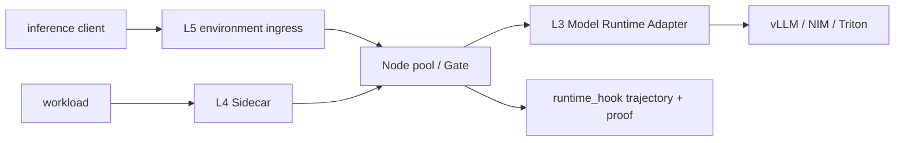

# System Blueprint — AI Inference Factory


> **SYSTEM BLUEPRINT · PUBLIC / NATIVE SCANIOM** · no system `run.sh` shortcut

All names below are examples. Use your real values or discover existing objects with:

```bash
scaniom env list
scaniom workload list
scaniom node list
scaniom provider list
```

```bash
export YOUR_ENVIRONMENT="production"
export YOUR_WORKLOAD="customer-agent"
export YOUR_NODE_NAME="prod-ai-01"
export YOUR_MODEL="gpt-5-mini"
```


**Boundaries:** L3 · L4 · L5 · multi-Node



## Build sequence

```bash
scaniom env create "$YOUR_ENVIRONMENT" --type production
scaniom workload create "$YOUR_WORKLOAD" --env "$YOUR_ENVIRONMENT" --kind model
scaniom workload use "$YOUR_WORKLOAD"
scaniom address issue --workload "$YOUR_WORKLOAD" --ttl 24
scaniom policy set --env "$YOUR_ENVIRONMENT" --mode enforce

scaniom fabric add nodes --env "$YOUR_ENVIRONMENT" --prefix inference-node --count 2
scaniom node list

scaniom runtime identity bootstrap --workload "$YOUR_WORKLOAD" --attachments l3,l4,l5
scaniom attach l3 --workload "$YOUR_WORKLOAD" --kind "$YOUR_RUNTIME_KIND" --endpoint "$YOUR_RUNTIME_URL" --model "$YOUR_MODEL" --run
scaniom attach l4 --workload "$YOUR_WORKLOAD" --port 8790
scaniom attach l5 --environment "$YOUR_ENVIRONMENT" --port 8791 --run

scaniom attach status --workload "$YOUR_WORKLOAD"
scaniom live --env "$YOUR_ENVIRONMENT" --limit 20
scaniom trajectory list --limit 100
scaniom proof correlated list --limit 50
```

Supported released L3 kinds include `vllm`, `nvidia_nim`, `triton`, and `openai_compatible`. Gate must execute before inference and completion comes from `runtime_hook` evidence plus signed proof.
