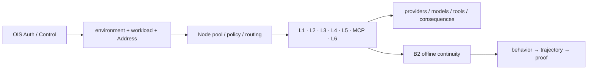

# System Blueprint — IFOC · Full Immune Fabric Operations Center


> **SYSTEM BLUEPRINT · PUBLIC / NATIVE SCANIOM** · no system `run.sh` shortcut

All names below are examples. Use your real values or discover existing objects with:

```bash
scaniom env list
scaniom workload list
scaniom node list
scaniom provider list
```

```bash
export YOUR_ENVIRONMENT="production"
export YOUR_WORKLOAD="customer-agent"
export YOUR_NODE_NAME="prod-ai-01"
export YOUR_MODEL="gpt-5-mini"
```


**Boundaries:** L1 · L2 · L3 · L4 · L5 · MCP · L6 · multi-Node · multi-provider · continuity



## Build sequence

Use the focused Labs as the safe build order; IFOC is composition, not a shortcut around them.

```bash
# Authority + scope
scaniom profile use cloud
scaniom profile test cloud
scaniom login
scaniom whoami
scaniom env create "$YOUR_ENVIRONMENT" --type production
scaniom workload create "$YOUR_WORKLOAD" --env "$YOUR_ENVIRONMENT" --kind application
scaniom workload use "$YOUR_WORKLOAD"
scaniom address issue --workload "$YOUR_WORKLOAD" --ttl 24
scaniom policy set --env "$YOUR_ENVIRONMENT" --mode enforce

# Multi-Node fabric
scaniom fabric add nodes --env "$YOUR_ENVIRONMENT" --prefix ifoc-node --count 2
scaniom node list

# Provider routes / BYOK
scaniom provider add openai --node "$YOUR_NODE_NAME" --workload "$YOUR_WORKLOAD" --model "$YOUR_MODEL"
scaniom secret configure OPENAI_API_KEY --node "$YOUR_NODE_NAME"
scaniom provider add anthropic --node "$YOUR_NODE_NAME" --workload "$YOUR_WORKLOAD" --model "$YOUR_MODEL"
scaniom secret configure ANTHROPIC_API_KEY --node "$YOUR_NODE_NAME"
scaniom node restart

# All seven runtime scopes before execution/continuity exercises
scaniom runtime identity bootstrap --workload "$YOUR_WORKLOAD" --attachments l1,l2,l3,l4,l5,mcp,l6
scaniom runtime identity status --workload "$YOUR_WORKLOAD"

# Place the seven boundaries using D02-D08 native runbooks.
scaniom attach status --workload "$YOUR_WORKLOAD"

# Continuity / evidence
scaniom runtime continuity --env "$YOUR_ENVIRONMENT"
scaniom node health
scaniom live --env "$YOUR_ENVIRONMENT" --limit 20
scaniom trajectory list --limit 100
scaniom proof correlated list --limit 50
scaniom authority --category all --limit 30
```

For full seven-boundary offline continuity, follow D10's real network-isolation procedure: establish authority online, remove only Node→Control reachability, execute through already-known authority, restore the same path, then verify ordered replay and seven proofs.
