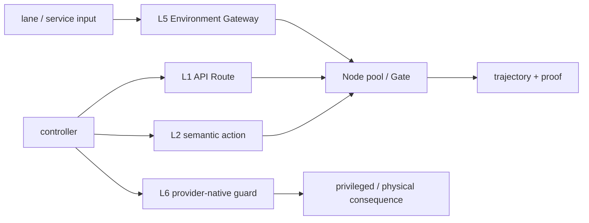

# System Blueprint — Autonomous Lanes


> **SYSTEM BLUEPRINT · PUBLIC / NATIVE SCANIOM** · no system `run.sh` shortcut

All names below are examples. Use your real values or discover existing objects with:

```bash
scaniom env list
scaniom workload list
scaniom node list
scaniom provider list
```

```bash
export YOUR_ENVIRONMENT="production"
export YOUR_WORKLOAD="customer-agent"
export YOUR_NODE_NAME="prod-ai-01"
export YOUR_MODEL="gpt-5-mini"
```


**Boundaries:** L1 · L2 · L5 · L6 · multi-Node



## Build sequence

```bash
scaniom env create "$YOUR_ENVIRONMENT" --type production
scaniom workload create "$YOUR_WORKLOAD" --env "$YOUR_ENVIRONMENT" --kind application
scaniom workload use "$YOUR_WORKLOAD"
scaniom address issue --workload "$YOUR_WORKLOAD" --ttl 24
scaniom policy set --env "$YOUR_ENVIRONMENT" --mode enforce

scaniom fabric add nodes --env "$YOUR_ENVIRONMENT" --prefix lane-node --count 2
scaniom node list

scaniom provider add openai --node "$YOUR_NODE_NAME" --workload "$YOUR_WORKLOAD" --model "$YOUR_MODEL"
scaniom secret configure OPENAI_API_KEY --node "$YOUR_NODE_NAME"
scaniom node restart

scaniom runtime identity bootstrap --workload "$YOUR_WORKLOAD" --attachments l1,l2,l5,l6
scaniom attach l1 --workload "$YOUR_WORKLOAD" --node "$YOUR_NODE_NAME" --preset openai --model "$YOUR_MODEL"
scaniom attach l2 --workload "$YOUR_WORKLOAD" --lang typescript
scaniom attach l5 --environment "$YOUR_ENVIRONMENT" --port 8791 --run
scaniom attach l6 --workload "$YOUR_WORKLOAD" --provider "$YOUR_PROVIDER" --adapter "$YOUR_L6_ADAPTER" --hook "$YOUR_L6_HOOK" --port 8794 --run

scaniom attach status --workload "$YOUR_WORKLOAD"
scaniom live --env "$YOUR_ENVIRONMENT" --limit 20
scaniom trajectory list --limit 100
scaniom proof correlated list --limit 50
```

L6 completion still requires a real allowed consequence followed by observe evidence; a synthetic guard-only probe cannot prove the physical/privileged consequence path.
