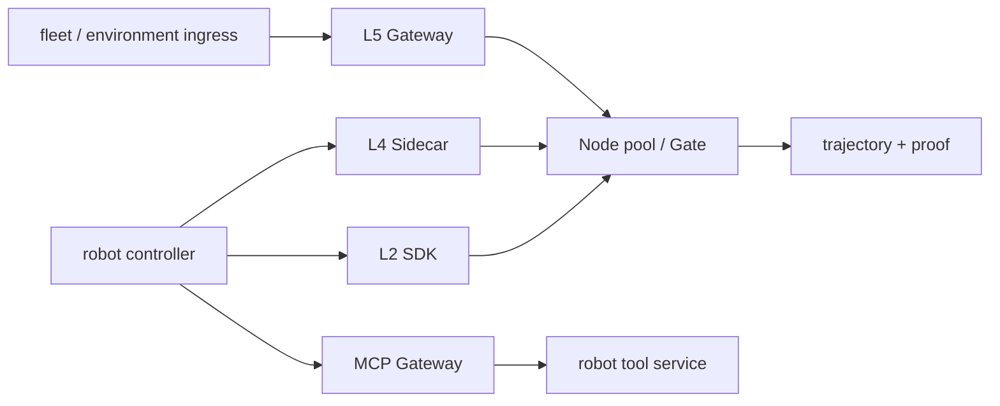

# System Blueprint — Robot Fleet


> **SYSTEM BLUEPRINT · PUBLIC / NATIVE SCANIOM** · no system `run.sh` shortcut

All names below are examples. Use your real values or discover existing objects with:

```bash
scaniom env list
scaniom workload list
scaniom node list
scaniom provider list
```

```bash
export YOUR_ENVIRONMENT="production"
export YOUR_WORKLOAD="customer-agent"
export YOUR_NODE_NAME="prod-ai-01"
export YOUR_MODEL="gpt-5-mini"
```


**Boundaries:** L2 · L4 · L5 · MCP · multi-Node



## Build sequence

```bash
scaniom env create "$YOUR_ENVIRONMENT" --type production
scaniom workload create "$YOUR_WORKLOAD" --env "$YOUR_ENVIRONMENT" --kind application
scaniom workload use "$YOUR_WORKLOAD"
scaniom address issue --workload "$YOUR_WORKLOAD" --ttl 24
scaniom policy set --env "$YOUR_ENVIRONMENT" --mode enforce

scaniom fabric add nodes --env "$YOUR_ENVIRONMENT" --prefix robot-node --count 2
scaniom node list
# Start the printed Nodes, then set the real IDs from scaniom node list.
export YOUR_NODE_IDS="node-id-a,node-id-b"
scaniom fabric pool create --env "$YOUR_ENVIRONMENT" --name robot-pool --desired 2 --min 1 --max 2 --capabilities l2,l4,l5,mcp --nodes "$YOUR_NODE_IDS"
scaniom fabric workload pools --workload "$YOUR_WORKLOAD" --pools robot-pool

scaniom runtime identity bootstrap --workload "$YOUR_WORKLOAD" --attachments l1,l2,l4,l5,mcp
scaniom attach l2 --workload "$YOUR_WORKLOAD" --lang typescript
scaniom attach l4 --workload "$YOUR_WORKLOAD" --port 8790
scaniom attach l5 --environment "$YOUR_ENVIRONMENT" --port 8791 --run
scaniom attach mcp --workload "$YOUR_WORKLOAD" --server-id "$YOUR_MCP_SERVER_ID" --endpoint "$YOUR_MCP_SERVER_URL" --port 8793 --run

scaniom attach status --workload "$YOUR_WORKLOAD"
scaniom fabric routing preview --workload "$YOUR_WORKLOAD" --key "$YOUR_SESSION_KEY"
scaniom trajectory list --limit 100
scaniom proof correlated list --limit 50
```

The real deployment decides whether those boundaries live on edge hosts, VM services, Docker, or Kubernetes. Open Immune teaches the same Scaniom authority/evidence contract in each placement.
