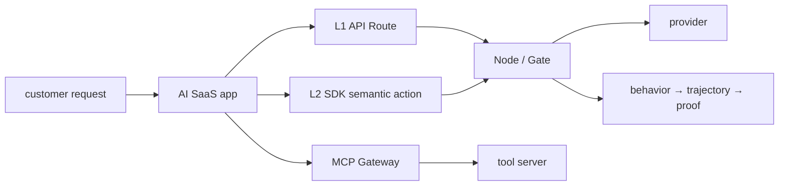

# System Blueprint — AI SaaS Operations Center


> **SYSTEM BLUEPRINT · PUBLIC / NATIVE SCANIOM** · no system `run.sh` shortcut

All names below are examples. Use your real values or discover existing objects with:

```bash
scaniom env list
scaniom workload list
scaniom node list
scaniom provider list
```

```bash
export YOUR_ENVIRONMENT="production"
export YOUR_WORKLOAD="customer-agent"
export YOUR_NODE_NAME="prod-ai-01"
export YOUR_MODEL="gpt-5-mini"
```


**Boundaries:** L1 · L2 · MCP



## Build sequence

```bash
scaniom profile use cloud
scaniom profile test cloud
scaniom login
scaniom whoami

scaniom env create "$YOUR_ENVIRONMENT" --type production
scaniom workload create "$YOUR_WORKLOAD" --env "$YOUR_ENVIRONMENT" --kind application
scaniom workload use "$YOUR_WORKLOAD"
scaniom address issue --workload "$YOUR_WORKLOAD" --ttl 24
scaniom node enroll "$YOUR_NODE_NAME" --env "$YOUR_ENVIRONMENT" --background
scaniom policy set --env "$YOUR_ENVIRONMENT" --mode enforce

scaniom provider add openai --node "$YOUR_NODE_NAME" --workload "$YOUR_WORKLOAD" --model "$YOUR_MODEL"
scaniom secret configure OPENAI_API_KEY --node "$YOUR_NODE_NAME"
scaniom node restart

scaniom runtime identity bootstrap --workload "$YOUR_WORKLOAD" --attachments l1,l2,l4,mcp
scaniom attach l1 --workload "$YOUR_WORKLOAD" --node "$YOUR_NODE_NAME" --preset openai --model "$YOUR_MODEL"
scaniom attach l2 --workload "$YOUR_WORKLOAD" --lang typescript
scaniom attach mcp --workload "$YOUR_WORKLOAD" --server-id "$YOUR_MCP_SERVER_ID" --endpoint "$YOUR_MCP_SERVER_URL" --port 8793 --run

scaniom attach status --workload "$YOUR_WORKLOAD"
scaniom live --env "$YOUR_ENVIRONMENT" --limit 20
scaniom trajectory list --limit 100
scaniom proof correlated list --limit 50
```

Use the Workbench Inspector for the resolved placement/integration steps and real MCP runtime token handling. The system is complete only from actual L1/L2/MCP evidence, not from topology configuration.
